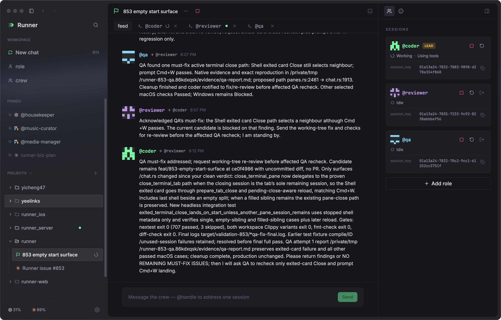
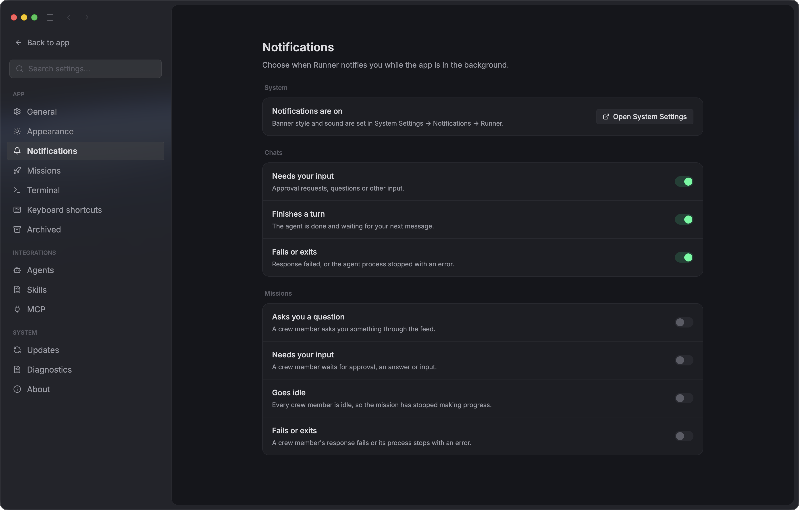

<!-- LOGO -->
<h1 align="center">
  
  <br />
  Runner
</h1>

<p align="center">
  <a href="https://github.com/yicheng47/runner/stargazers"></a>
  <a href="https://github.com/yicheng47/runner/releases"></a>
  <a href="./LICENSE"></a>
  <a href="https://discord.gg/6BrfZdHKNf"></a>
  <a href="#community"></a>
  <a href="https://runnersh.dev/downloads/"></a>
  <a href="https://ko-fi.com/yichengwang"></a>
</p>

<p align="center">
  English · <a href="./README.zh-CN.md">简体中文</a>
</p>

<p align="center">
  <strong>Where terminal agents work together.</strong>
  <br />
  Claude Code, Codex, Antigravity CLI, Copilot CLI and pi on the same task, in one mission. Each agent keeps its own TUI in a real terminal; Runner is what sits between them.
</p>

<p align="center">
  <a href="https://runnersh.dev/"><strong>Official website</strong></a>
  ·
  <a href="https://runnersh.dev/downloads/"><strong>Download Runner</strong></a>
</p>

<p align="center">
  
</p>

<p align="center">
  <a href="#features">Features</a>
  ·
  <a href="#demo">Demo</a>
  ·
  <a href="#supported-agents">Agents</a>
  ·
  <a href="#drive-runner-from-your-agents">CLI</a>
  ·
  <a href="#example-crew">Crew example</a>
  ·
  <a href="#community">Community</a>
  ·
  <a href="./CONTRIBUTING.md">Contributing</a>
</p>

> Alpha · Native macOS (Apple Silicon) and Windows (x64).

Runner brings CLI coding agents together in reusable crews, with real terminals and a shared mission feed. Your sessions and history stay on your machine.

## Features

<table>
  <tr>
    <td width="50%" valign="middle">
      <a href="assets/crews.png"></a>
    </td>
    <td width="50%" valign="middle">
      <h3>Reusable crews</h3>
      <p>Compose saved roles into a crew, choose a lead, and define shared team conventions. Review each slot's agent and model, adjust overrides, then launch a mission with the same team whenever you need it.</p>
    </td>
  </tr>
  <tr>
    <td width="50%" valign="middle">
      <a href="assets/mission_feed.png"></a>
    </td>
    <td width="50%" valign="middle">
      <h3>Missions and coordination</h3>
      <p>Each mission gives every crew slot a live terminal and a shared feed where agents coordinate and bring questions to you. Stop, resume or restart one slot without touching the rest. <a href="./docs/arch/arch.md">Architecture →</a></p>
    </td>
  </tr>
  <tr>
    <td width="50%" valign="middle">
      <a href="assets/mission_terminal.png"></a>
    </td>
    <td width="50%" valign="middle">
      <h3>Real terminals</h3>
      <p>Each agent keeps its own TUI in a real PTY on a GPU-drawn <code>alacritty_terminal</code> grid, with mouse reporting, IME input (Pinyin included), file-path paste and click-to-open, and a shell drawer beneath every chat and mission.</p>
    </td>
  </tr>
  <tr>
    <td width="50%" valign="middle">
      <a href="assets/chat_split.png"></a>
    </td>
    <td width="50%" valign="middle">
      <h3>Split tabs and windows</h3>
      <p>Split a tab as far as the window allows, drag panes to reorder, group tabs into folders, and open more windows with <code>⇧⌘N</code> or <code>Ctrl+Shift+N</code>.</p>
    </td>
  </tr>
  <tr>
    <td width="50%" valign="middle">
      <a href="assets/notifications.png"></a>
    </td>
    <td width="50%" valign="middle">
      <h3>Desktop notifications</h3>
      <p>While Runner is in the background, get notified when an agent needs input, finishes a turn or fails. Clicking a notification opens its chat or mission. Choose events in <strong>Settings → Notifications</strong>; chat notifications are on by default, and mission notifications are opt-in.</p>
    </td>
  </tr>
</table>

**Also included:**

- **Agents keep working when Runner is closed** — Sessions live in `runnerd`, Runner's background service. Quit the app, or let it crash, and reopen it to the same live terminals; stopped agents resume their own conversations on the next launch.
- **MCP servers and skills in one place** — **Settings → MCP** and **Settings → Skills** list each agent's own config and switch entries off per agent, changing only the entry you touched.
- **Projects** — Bind a working directory once; chats and missions started in it inherit the cwd and group in the sidebar.
- **Light and dark** — Carbon and Runner Light, plus Catppuccin, with an app palette and a terminal palette per mode. Claude Code follows the switch live.

## Demo

A quick tour of reusable roles, crew setup, split terminals, and coder/reviewer/QA coordination in a live mission.

https://github.com/user-attachments/assets/c2209015-1497-403a-98bd-cdc5502bee47

## Support Runner

If Runner is useful to you, consider supporting its ongoing development and maintenance.

- [](https://ko-fi.com/yichengwang) — Recommended for international supporters using PayPal.
- [](https://afdian.com/a/runnersh) — Recommended for supporters in mainland China using WeChat Pay or Alipay.

## Community

- Join the [Runner Discord](https://discord.gg/6BrfZdHKNf) for questions, workflows, bug reports and contribution discussions.
- Bugs and feature requests: [GitHub Issues](https://github.com/yicheng47/runner/issues).
- Thanks to [LINUX DO](https://linux.do) for providing a community for discussion and sharing open-source projects.
- 中文用户可以扫码加入 Runner 微信用户群。群二维码 7 天过期，如果扫码提示失效，请[提一个 issue](https://github.com/yicheng47/runner/issues/new) 提醒我更新。


## Drive Runner from your agents

Everything in Runner is also a `runner` command, so your agents, your scripts and you at a terminal can drive it. Your daily agent can plan a fix, hand it to a coder-and-reviewer crew, and keep working, while every session it started is still a real terminal you can open and watch.

A whole mission, driven from outside the app:

```sh
mission=$(runner mission start --crew <crew> --goal-file - -q < brief.md)
runner mission feed "$mission" --follow                   # the crew's messages as they arrive
runner msg post --mission "$mission" --to <lead> "message"
runner mission answer "$mission" <question_id> <choice>   # answer a question the crew asked you
runner mission stop "$mission"
```

| Commands | What they do |
| --- | --- |
| `runner mission` | Start, follow, answer, stop, resume and archive missions |
| `runner crew`, `runner role`, `runner project` | Create and edit crews, roles and projects |
| `runner chat start`, `runner session` | Start a chat; stop, resume, restart or archive any session |
| `runner msg`, `runner signal`, `runner ask` | How crew members talk to each other inside a mission |
| `runner status`, `runner daemon` | Check and stop Runner's background service |

`runner help` lists every command. Add `--json` for machine-readable output, which is what agents use. Commands start the background service when it is not running, so they work with the app closed.

**Setup.** On macOS, the first launch installs `runner` to `~/.local/bin`, or a writable `/usr/local/bin`, when that directory is already on the login `PATH`; otherwise it is one click in **Settings → General → Command line**. On Windows, Runner adds it to the user `PATH`. Agents need nothing: Runner installs a `runner` skill for every detected agent that points it at the version-matched `runner help agents` guide, and the **Runner skill for agents** switch in the same settings section turns that off.

## Supported agents

Runner integrates with **Codex, Claude Code, Antigravity CLI, GitHub Copilot CLI, pi, Cursor, Grok Build and OpenCode v2**. **TRAE CLI** is available as an opt-in runtime. Features and platform support vary by agent.

[Agent setup, capabilities and platform notes →](./docs/guide/reference/supported-agents.md)

## Example crew

Fresh installations include **Pair coding crew**: a coder implements and a reviewer checks the diff until the review is clean. Both use Codex by default; you can choose a different agent for either role.

[Build a crew and explore example prompts →](./docs/guide/guides/build-a-crew.md)

## Acknowledgements

- **[GPUI](https://github.com/zed-industries/zed/tree/main/crates/gpui)** and **[gpui-pre](https://github.com/longbridge/gpui-kit)** — the UI uses a crates.io snapshot of Zed's GPU-accelerated UI framework. Thank you to the Zed team for building and open-sourcing GPUI, and to gpui-kit and Jason Lee (huacnlee) for publishing gpui-pre; Zed's terminal crates were the architectural reference for Runner's terminal split.
- **[alacritty_terminal](https://github.com/alacritty/alacritty)** — the terminal grid, parser, and scrollback under every pane.
- **[xterm.js](https://github.com/xtermjs/xterm.js)** — the procedural box-drawing glyph table is transcribed from the WebGL addon under its MIT notice (`crates/runner-app/LICENSE.xterm`).
- **[Windows Terminal ConPTY](https://github.com/microsoft/terminal)** — Windows builds bundle Microsoft's `conpty.dll` and `OpenConsole.exe` under the MIT notice (`crates/runner-app/LICENSE.conpty`).
- **[Sparkle](https://sparkle-project.org)** — the macOS updater.

## Author

Runner is written and maintained by **Yicheng Wang** (Jason Wang, 王逸成) — [@yicheng47](https://github.com/yicheng47) on GitHub.

## License

MIT. Copyright (c) 2026 Yicheng Wang (Jason Wang). You can use, modify, and redistribute Runner for anything, including at work and inside closed-source products, as long as you keep the copyright notice (see `LICENSE`). Versions released from 2026-08-22 through 2026-09-22 were published under GPL-3.0-only and remain available under that license.
