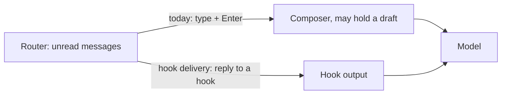

# 1046 — Deliver inbox notices through agent hooks

> Tracking issue: [#1046](https://github.com/yicheng47/runner/issues/1046). Priority: P2.
> Status: draft for discussion, 2026-10-28. This is #1046's evaluation and the design it leads to; nothing is built. A [test of the agents' hooks](#spike-before-building) comes before implementation.
> Related: [#940](https://github.com/yicheng47/runner/issues/940) and [#1018](https://github.com/yicheng47/runner/issues/1018) (draft-hold bugs), [#861](https://github.com/yicheng47/runner/issues/861) (status), [#1012](https://github.com/yicheng47/runner/issues/1012) (Codex launch overrides), [748](./748-mission-watch-delivery.md) (updates to a starting chat).

## The problem

When a mission member has unread messages, the router types ``[inbox] N new messages — run `runner msg read` to view.`` into the agent's terminal and presses Enter ([sessions and routing §5](../tech/sessions-and-routing.md#5-what-the-router-actually-delivers)). Those bytes land in the agent's composer, the same place the person types. If the composer holds an unsent draft, the notice is appended to it and Enter submits both.

To prevent that, Runner reads the screen to decide whether the composer holds a draft (`InputTracker` in `runner-terminal/src/input_state.rs`, the hold in `SessionModel::draft_hold`), and reads it again to confirm that the notice was submitted (`runner-terminal/src/delivery_probe.rs` and the dispatcher's confirmation window). Every agent draws its composer differently, and redraws break the detection. #940 and #1018 were both stale holds that blocked delivery behind an empty Codex composer.

The goal of this feature: **nudge the agent without ever touching the person's draft.**

## The idea

An agent has two ways in:

- **Keystrokes** go into the composer. That is how the notice travels today, and why drafts are at risk.
- **Hook output** goes into the model's context. The agent runs a hook at fixed points (a turn ends, a tool finishes, the person submits a prompt) and reads what the hook prints. Some of that output is added to what the model sees. It never passes through the composer.

Runner already installs hooks in both agents for status: Claude Code runs `runner hook report` as a command hook at 14 events, and Codex calls the `report` tool of Runner's `runner_hooks` MCP server at its events. Today the reply is empty: nothing for Claude Code, `{}` for Codex.

**Hook delivery** means that reply carries the notice when the member has unread messages. For example, at the end of a turn:

```json
{"decision":"block","reason":"[inbox] 2 new messages — run `runner msg read` to view.","systemMessage":"[inbox] 2 new messages"}
```

The agent does not end the turn. The model receives `reason` as its next instruction and runs `runner msg read`, and the person sees the `systemMessage` line. After a tool call, or when the person submits a prompt, the notice is added as context instead:

```json
{"hookSpecificOutput":{"hookEventName":"PostToolUse","additionalContext":"[inbox] 2 new messages — run `runner msg read` to view."},"systemMessage":"[inbox] 2 new messages"}
```



Because hook delivery never writes to the composer, it cannot affect a draft and presses no Enter, so neither draft detection nor submit confirmation applies to it. The cost: a hook only fires when the agent does something. An agent that sits idle runs no hooks.

## What the agents support

Checked on 2026-10-28 against the installed Claude Code 2.1.312 (its settings and hook-output schemas) and Codex `origin/main` at [`bea47c0`](https://github.com/openai/codex/tree/bea47c06dfac12ecce362090418e12a6faeedbf9) (source); the installed Codex is 0.164.0. These are read from schemas and source, not run; the [spike](#spike-before-building) confirms them.

| When | Claude Code | Codex |
| --- | --- | --- |
| Turn ends | `Stop` returns `decision: "block"` and `reason`; the turn continues with `reason` as the next instruction. Input carries `stop_hook_active`; consecutive blocks are capped (`CLAUDE_CODE_STOP_HOOK_BLOCK_CAP`). | `Stop`, same contract. `reason` becomes a continuation prompt (`core/src/session/turn.rs`). Input carries `stop_hook_active`. |
| Person submits a prompt | `UserPromptSubmit` returns `additionalContext`. | Same (`inspect_pending_input` in `core/src/hook_runtime.rs`). |
| After a tool call | `PostToolUse` returns `additionalContext`; failed calls run `PostToolUseFailure`. | `PostToolUse` returns `additionalContext`, for some tools and only on success; see [gaps](#where-codex-hooks-do-not-fire). |
| Agent idle at its prompt | A command hook with `asyncRewake: true` runs in the background and wakes the model when it exits with code 2. | Nothing. Async hooks cannot change control flow (`can_apply_control_effects`); `PreModelRequest`/`PostModelRequest` only observe. |
| Shown to the person | `systemMessage` is shown. An `asyncRewake` wake shows a summary, by default "Stop hook feedback". | Context-only output is hidden (`hook_run_is_quiet_success` in `tui/src/history_cell/hook_cell.rs`). `systemMessage` shows as a hook warning line; a `Stop` block shows its reason. |
| Main thread only | Hook input carries `agent_id` only inside a subagent. | Runner already drops reports carrying `agent_id`. |

Codex runs an `mcp_tool` hook's result through the same parser as a command hook's output (`mcp_tool_results_use_command_hook_output_contract` in `hooks/src/engine/mcp_runner_tests.rs`), so the existing `runner_hooks` `report` tool can return the JSON above. `Stop`, `PostToolUse` and `UserPromptSubmit` are already in `codex_status::EVENTS`, so Codex needs no new launch flags.

Claude Code also has MCP channels, which push messages into a running session. They are unavailable on third-party providers, need the org policy `channelsEnabled`, and need an allowlisted plugin or `--dangerously-load-development-channels`. They are not a default path.

### Where Codex hooks do not fire

1. **A turn that ends badly runs no `Stop`.** `Stop` runs only on a normal finish. An API error ends the turn without it (Runner notes this in `codex_status.rs`); an interrupt runs `Interrupt`, which cannot add context.
2. **`PostToolUse` covers some tools, on success only.** Shell commands, `write_stdin`, `apply_patch`, MCP and extension tools return a payload; failed calls, plan updates, image views, multi-agent tools, tool search and user-input requests do not. Long reasoning or a run of failing commands gives no mid-turn point.
3. **`/compact` makes its own turn without `UserPromptSubmit`** (noted in `codex_status.rs`).
4. **An idle agent runs nothing.**
5. **Runner's hooks can be absent.** A role can disable hooks, and #1012 may add a launch mode without Runner's injected hooks.

A missing hook never endangers a draft; it only means no delivery at that moment. The design treats Codex hooks as a fast path, and the idle path must catch every turn that ends without one. Runner already learns those turn ends from Codex's transcript.

## Delivery policy

For each notice, in order:

1. **A hook fires first:** deliver through it. `Stop` blocks with the notice; `PostToolUse` and `UserPromptSubmit` add it as context. Every delivery also sets `systemMessage`, so the person sees what the agent was told.
2. **The agent is idle:**
   - Claude Code: an `asyncRewake` waiter wakes it with the notice. Nothing is typed.
   - Codex and runtimes without suitable hooks: type the notice, with today's draft holds and confirmation.
3. **The hook bridge is down, or the role disabled hooks:** today's typed path, unchanged.

| | Working | Person submits | Idle |
| --- | --- | --- | --- |
| Claude Code | Hook | Hook | `asyncRewake` |
| Codex | Hook when one fires | Hook | Typed, with holds |
| Other runtimes | Typed, as today | Typed, as today | Typed, as today |

A hold on idle Codex now ends by itself: if the person submits their draft, the notice rides along through `UserPromptSubmit`; if the agent starts any turn, `PostToolUse` or `Stop` carries it. A stale hold of the #940/#1018 kind delays the notice to the next turn instead of blocking it.

## Design

### The hook reply carries the notice

Today the daemon admits a hook report into the session's queue and answers `Response::hook_report(Ok(()))` before the status reducer reads it (`session/hook_queue.rs`). For `Stop`, `PostToolUse` and `UserPromptSubmit` on the main thread, the admission answer gains an optional notice, taken from the session's mission dispatcher: the notice text when the member has unread messages beyond its [notified-through mark](#notified-through-replaces-submit-confirmation), otherwise nothing. The hook CLI is Runner's own binary in the app data directory, so CLI and daemon change together; the hook protocol `VERSION` still rises with the response shape.

- `runner hook report` prints the notice in the runtime's format for that event.
- `runner hook serve` returns it as the `report` tool's text content.
- An unreachable daemon or the 250 ms deadline prints today's neutral output: no notice, and the idle path covers it later.

`Stop` blocks only when there are messages beyond the notified-through mark, so a notice is never repeated and the turn is never held open waiting for messages. This differs from the Stop-hook watch [748](./748-mission-watch-delivery.md) rejected, which kept a turn open for a whole mission.

### Notified-through replaces submit confirmation

Each subscriber keeps a notified-through mark: the last inbox message a notice covered. A hook offers a notice only for messages past it, and handing a notice to the hook CLI advances it. This is the "exactly once" for notices; nothing reads the screen.

Reading stays the only acknowledgment ([sessions and routing §4](../tech/sessions-and-routing.md#reading-is-the-acknowledgment)). If a delivered notice is lost (the CLI missed its deadline, or the agent dropped the output), the read watermark does not move. When the existing two-minute redelivery backoff passes with messages still unread, the dispatcher resets the notified-through mark to the read watermark, so the next hook or the idle path offers the notice again.

### Status

A `Stop` that Runner blocks is not a turn end. Claude Code and Codex status both treat `Stop` as Idle or Completed today. When the daemon answers a `Stop` with a notice, the reducer keeps the session Working, raises no completion attention and arms no unread response, as the typed path's `synthesize_wake_busy` does for a confirmed wake.

### Idle Claude Code: the rewake waiter

Runner adds a second `Stop` command hook with `asyncRewake: true`, running a new `runner hook wait`. It connects to the daemon and waits. When the member has messages past the notified-through mark, it writes the notice to stderr and exits with code 2, which wakes the model. It exits 0 without output when a turn starts or the session ends, and a later `Stop` replaces an earlier waiter, so a session has at most one.

The person's draft stays in the composer untouched; the agent starts a turn while it sits there.

### Idle Codex: typed, as today

Idle Codex keeps `InputTracker`, the holds and the confirmation window. Whether an unknown composer state should wait for the next hook or type is an [open question](#open-questions).

## What the screen code still does

Nothing is deleted. What changes is which deliveries reach it.

| Code | Claude Code | Codex | Other runtimes |
| --- | --- | --- | --- |
| Draft detection (`input_state.rs`, `draft_hold`) | Fallback only: bridge down or hooks disabled | Idle delivery | Unchanged |
| Submit confirmation (`delivery_probe.rs`, confirmation window) | Fallback only | Idle delivery | Unchanged |

Other runtimes with hooks (Copilot, Grok, Antigravity, OpenCode, Cursor Agent, pi) get the same evaluation one at a time later.

## Spike before building

Hand-written hook configs outside Runner, on Claude Code 2.1.312 and Codex 0.164.0. Record each result, and a screenshot of what the person sees, in `docs/tests/1046-hook-inbox-delivery.md`.

| Check | Pass when |
| --- | --- |
| Claude `Stop` block with `reason` and `systemMessage` | The turn continues, the model follows the reason, the person sees one line |
| Claude `PostToolUse` and `UserPromptSubmit` `additionalContext` | The model acts on it in that turn |
| Claude `asyncRewake` from idle, with and without a draft | The model wakes; a draft stays in the composer, unsent |
| Codex `Stop` block through an `mcp_tool` hook | The turn continues with the reason |
| Codex `PostToolUse` context through an `mcp_tool` hook, and a failed call | Context reaches the model; the failed call runs no hook |
| Codex `systemMessage` | Shown to the person |
| Codex interrupt and API error | No `Stop` runs, confirming gap 1 |

## Affected guide pages

[Missions](../guide/concepts/missions.md) and its zh-CN copy: the **Inbox waiting** paragraph describes the draft hold, which then applies only to idle Codex and runtimes without hooks. [Supported agents](../guide/reference/supported-agents.md): per-runtime delivery. [Drive Runner from agents](../guide/guides/drive-runner-from-agents.md) keeps its instruction to run `runner msg read` when an `[inbox]` notice arrives; the notice text does not change.

## Out of scope

Building the delivery path before the spike; status detection ([#861](https://github.com/yicheng47/runner/issues/861), [#1051](https://github.com/yicheng47/runner/issues/1051)); hooks of other runtimes; delivering to a starting chat ([748](./748-mission-watch-delivery.md)), although hook delivery is a non-typing route that 748's redesign could use.

## Open questions

1. **Rewake under a draft.** An idle Claude Code wakes while the person is typing a draft. The draft is safe, but a turn starts under them. Recommendation: accept.
2. **Mid-turn delivery.** Deliver at `PostToolUse`, or only at `Stop`? Recommendation: both, because a "stop, wrong direction" message matters most mid-turn, and typed notices already reach working agents today.
3. **Idle Codex with an unknown composer.** Today no draft evidence counts as ready, and Runner types. Waiting instead protects any draft Runner cannot see, but an unattended idle Codex would then never wake, because no hook fires. Recommendation: keep typing on no evidence; revisit after the spike.
4. **#1012.** If Codex gets a launch mode without Runner's injected hooks for Remote Control, that mode uses the typed path for every state.
