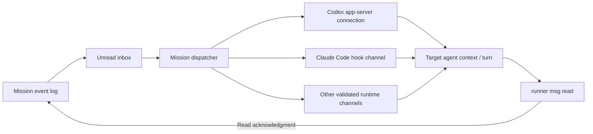

# 1046 — Deliver mission inbox notices without the composer

> Tracking issue: [#1046](https://github.com/yicheng47/runner/issues/1046).
> Status: draft for discussion, revised 2026-10-29; deferred to a future update on 2026-10-30. Nothing is built. This replaces the earlier proposal to combine hooks with typed fallback delivery.
> Codex: [#1012](https://github.com/yicheng47/runner/issues/1012), which would have given Runner a connection to Codex's app-server, was closed as not planned on 2026-10-30. Runner keeps each Codex session's embedded app-server, so Codex has no channel yet. The #1012 spec and hand-test record remain on the branch of the closed [PR #1063](https://github.com/yicheng47/runner/pull/1063).
> Related: [#940](https://github.com/yicheng47/runner/issues/940) and [#1018](https://github.com/yicheng47/runner/issues/1018) (draft holds), [#861](https://github.com/yicheng47/runner/issues/861) and [#1051](https://github.com/yicheng47/runner/issues/1051) (status), [748](./748-mission-watch-delivery.md) (updates to a starting chat).

## Motivation

Today the router types ``[inbox] N new messages — run `runner msg read` to view.`` into a mission member's terminal and presses Enter. Those bytes enter the same composer the person uses. Runner detects drafts and confirms submission by reading the terminal, but redraws and runtime-specific composer layouts make that fragile. #940 and #1018 were stale holds behind an empty Codex composer. The [current delivery walkthrough](../tech/mission-message-delivery.md) follows the implemented path and its recovery rules.

A hook can carry the notice into model context without touching the composer, but hooks alone do not wake idle Codex. Adding hooks while keeping typed notices for idle sessions, unavailable bridges or other runtimes would retain the composer machinery and its failure modes.

Jason's decision on 2026-10-29: **replace automatic composer nudges completely, or keep the current delivery mechanism until a complete replacement is ready.** Different runtimes can implement different native channels. Every replacement channel must cover both working and idle sessions; none may fall back to typing.

## Scope and delivery contract

Runner keeps the mission event log, addressed inboxes, `runner msg read` and cumulative read acknowledgments. Only the channel carrying the inbox notice changes. The notice stays a short pointer; message bodies remain in the log.

Each mission runtime adapter must provide a channel separate from its composer with these properties:

1. **Working:** make a notice available to the model at a supported execution boundary without writing terminal input or interrupting a tool to submit it.
2. **Idle:** start the agent processing a notice without waiting for the person to submit another prompt. This must work after startup, resume and every supported turn exit, including interruption and failure.
3. **Draft safety:** preserve an existing draft exactly, including when a notice starts work while the person is composing it. The notice causes no composer write and no simulated Enter.
4. **Identity and lifecycle:** deliver only to the intended mission member's current conversation and launch generation. Reject stale callbacks, retired threads and native subagents.
5. **Failure:** leave messages queued when a channel is disconnected, disabled or unsupported. Recover through that channel when available; never switch to terminal typing.
6. **Acknowledgment:** an accepted notice does not mark messages read. Only the existing unfiltered read path advances the read watermark.

A safe execution boundary does not promise immediate preemption during a model request or a long-running tool. Waiting for the next boundary while working is acceptable; depending on a new human prompt to wake an idle member is not.



## Runtime channels and evidence

| Runtime | Proposed channel | Evidence and remaining gate |
| --- | --- | --- |
| Codex | None today. A connection to an app-server that Runner starts, for both working and idle delivery. | PR #1063's hand test showed draft-preserving `turn/start` on Codex 0.165.0 against a separate server. Runner has no such server since #1012 was closed. |
| Claude Code | Context from synchronous hooks while working; `asyncRewake` for idle delivery. | Hook schemas and official documentation support the pieces. A complete, continuously available idle wake-up path has not been demonstrated. |
| Antigravity CLI, pi, Copilot CLI, Cursor Agent, Grok, OpenCode and opt-in TRAE | A native hook, extension or control API that satisfies the same contract. | Not evaluated for this replacement. Each remains a release gate; status hooks alone do not establish message delivery or idle wake-up. |

The table is a readiness record, not a policy to use native delivery for some runtimes and typed delivery for the rest. Evaluate every supported mission runtime and platform before the final cutover. Do not silently remove a runtime from mission support to claim completion.

### Codex: needs a server Runner can reach

Each Codex session runs its own app-server inside the TUI process, with no socket Runner can connect to. A Codex channel needs the TUI attached with `--remote` to an app-server that Runner starts, plus a Runner client connection to it. #1012 explored this and was closed; no open issue owns that server. The rules below describe delivery once the connection exists. Codex hook delivery is not another path.

- **Idle:** send the notice through `turn/start` on the member's thread.
- **Working:** use `turn/steer` with the expected active turn ID. Validate this operation against the installed version's generated schema and live behavior before choosing it for implementation.
- **Turn-state race:** if a request is explicitly rejected because the active turn changed or ended, refresh native state and choose the applicable operation again. Serialize this with the member's pending delivery attempt.
- **Ambiguous connection loss:** retain the unread backlog and record the uncertain offer. Do not immediately resend the same notice as a new turn solely because the response was lost.
- **Recovery:** when the connection is restored and subscribed to the bound thread, make the pending backlog eligible again. No bytes are written through the PTY.

The [official app-server reference](https://learn.chatgpt.com/docs/app-server) documents `turn/start`, active-turn steering and native turn events. The [#1012 hand-test record](https://github.com/yicheng47/runner/blob/b01059ac08b6a9df9d64645e4f9c9c08540583f3/docs/tests/1012-codex-app-server.md) reports that a second client started a turn while a TUI draft remained unchanged, and Enter afterwards submitted only that draft. It also reports successful event subscription and separate thread environments. These are tests outside Runner, not completed Runner integration checks.

The server work comes first: launch settings, environment forwarding, thread identity, resume/fork, status and approvals with several clients, on every platform. Until it exists, Codex blocks the cutover; the final mission delivery path cannot rely on the embedded launch or typed nudges.

### Claude Code: prove a complete hook channel

Runner's existing command hook can return an optional notice in the event's supported output shape. `PostToolUse` and `UserPromptSubmit` add context; `Stop` can request continuation with a reason. For example:

```json
{"hookSpecificOutput":{"hookEventName":"PostToolUse","additionalContext":"[inbox] 2 new messages — run `runner msg read` to view."},"systemMessage":"[inbox] 2 new messages"}
```

The proposed idle mechanism is a command hook with `asyncRewake: true`, running `runner hook wait`. A pending notice makes the waiter print it and exit with code 2, waking the model. The [official hook reference](https://code.claude.com/docs/en/hooks) documents that behavior and an enforced timeout for `asyncRewake`.

A waiter installed only at `Stop` is insufficient. The spike must establish how idle coverage begins after initial startup and resume, and survives interruption, API failure, daemon disconnection and timeout. If the hook channel cannot cover those states, choose a different complete native channel before implementation. A timed-out waiter with no successor cannot be treated as a healthy subscription.

At most one idle waiter belongs to a session generation. New work, a replacement waiter, session stop and respawn retire the old waiter without delivering to the wrong turn. Waiting needs a separate connection lifecycle from today's 250 ms hook-report request. Normal hook reports remain bounded and return neutral output on failure; the backlog stays pending.

Return the notice in a user-visible form as well as model context when the runtime supports it, and verify what actually appears in the TUI. An idle wake must leave the person's draft unchanged and unsent.

Other native channels, including provider-dependent channels, are candidates only after their availability and full working/idle behavior are established. None is assumed to cover all Claude Code configurations merely because it exists.

## Shared dispatch and acknowledgment

The mission dispatcher remains the single owner of notification decisions. A hook callback, an idle waiter and a native API request must claim the same unread range through that owner, rather than independently reading a count and sending a notice.

Publish the recipient's unread count, latest inbox message ID and read watermark as one completed bus snapshot. Preserve the existing `message_nudge` behavior, which requests dispatch for new messages even when the final unread count is unchanged. Track the offered-through message ID and an in-flight claim for the current session generation so concurrent callbacks cannot offer the same range independently.

An offer means the notice was handed to the runtime channel; it does not prove the model read or acted on it. Offer bookkeeping suppresses immediate duplicates and remains rebuildable in memory. The read watermark remains the durable acknowledgment. Do not describe this as exactly-once notice delivery or task execution.

Keep the existing two-minute redelivery backoff as the starting policy for unread messages whose notice was accepted or may have been accepted. After backoff, make the still-unread range eligible for another notice through the native channel. New messages can request a new offer without waiting for that backoff. Known channel failures keep the backlog queued and retry when availability returns. Reconcile on reconnect and restart without moving the read watermark.

Human questions and answers keep their current routing: the router converts a response into an ordinary message to the recorded asker. A notification never answers or dismisses an approval or question. If a runtime cannot safely accept the notice while human interaction is pending, retain it until the runtime permits delivery.

## Hook continuation and status

A hook delivery decision must accompany the admitted report before the session reducer processes it. A `Stop` for which Runner requests continuation must not first publish completion attention or an unread response and then be patched back to Working. Reconcile the requested continuation with subsequent native evidence, including a failed or superseded continuation, so a lost hook result cannot leave the session permanently Working.

At `Stop`, recheck whether a notice offered earlier in the turn was actually read. An ignored mid-turn notice may justify a bounded continuation for the same unread range. Respect `stop_hook_active`, runtime continuation limits and per-range attempt bookkeeping; never repeatedly block on the same backlog without progress. If no notice is pending, return immediately. Never keep a model turn open waiting for a future message.

Codex would use the app-server connection's native turn events for these decisions. It needs no `Stop` hook or screen-based submission confirmation for this feature.

## Remove automatic composer nudges

The cutover removes the mission notification path that writes notice text and delayed Enter, probes terminal rows for confirmation, resubmits a leftover notice and synthesizes busy state from that submission. Mission notification scheduling no longer depends on composer draft holds or `InputProbe`.

Remove code whose only consumer was that notification path, and its obsolete notification-specific tests and UI reasons. Shared local-input tracking, ordinary user typing and first-turn prompt delivery still have their own consumers; trace those uses before deleting a helper. Document the resulting meaning of **Inbox waiting** and any unavailable-channel feedback. Any new or changed UI presentation needs the project's normal Pencil design before implementation.

A disabled hook, missing app-server, unsupported runtime version or disconnected channel leaves the inbox queued and reports delivery unavailability through the mission's normal feedback. There is no setting, compatibility branch or error path that silently restores composer injection after cutover.

## Implementation phases

1. **Prove runtime coverage.** Build Codex's app-server connection, verify active and idle delivery, and establish a complete channel for every other supported mission runtime. Record exact versions, platforms, results and gaps in `docs/tests/1046-inbox-delivery.md`. Unproven cells block the cutover.
2. **Implement the replacement.** Add the shared offer/claim bookkeeping and each validated runtime channel, preserving inbox/read semantics and lifecycle identity. Keep development work isolated while the current production delivery remains in use; do not ship a partial native/typed delivery policy.
3. **Cut over and remove typing.** Once every supported runtime satisfies the contract, switch mission notification delivery as one policy change, delete its composer-injection machinery, update the guide and complete the selected validation below.

## Verification

Before implementation, run bounded spikes in isolated test sessions using the current development-app and agent-configuration isolation rules. The #1012 hand-test evidence is reusable only for the versions and behaviors it records. Do not claim live validation from schemas or documentation alone.

| Check | Required result |
| --- | --- |
| Codex idle API delivery with an unsent draft | Notice starts work through the bound app-server thread; the draft remains identical, and later Enter submits only the draft. |
| Codex active API delivery and turn-end race | Notice reaches the active turn or a subsequent turn under the shared claim; no duplicate request is created from a known rejection. |
| Codex connection loss, restart, resume/fork and multiple threads | Backlog remains unread until read, delivery resumes on the correct thread, and thread environments/identity remain isolated. |
| Claude context hooks and `Stop` continuation | Model receives the notice, the TUI shows the intended feedback, and a requested continuation does not publish false completion or loop on the same range. |
| Claude idle coverage | Startup, resume, normal completion, interrupt, failure, waiter expiry and daemon reconnect all retain or restore automatic wake-up without a human prompt. |
| Every remaining supported mission runtime | Working and idle delivery satisfy the same contract on every supported platform; unsupported cells remain explicit blockers. |
| Draft, approval and unavailable-channel cases | No notification text or generated Enter reaches the composer; pending interaction is not answered; messages remain queued when delivery is unavailable. |
| Concurrent callbacks, bursts and read races | One owner claims each offer; a later message survives an earlier read acknowledgment; unchanged-count batches still request delivery. |
| Lost replies, ignored offers and reconstruction | Read watermark never advances on an offer; unread messages become eligible after backoff or recovery; stale generations cannot deliver. |
| Removal audit | No automatic mission-notification PTY write, delayed Enter, composer probe or typed fallback remains reachable. |

Use in-process dispatcher, protocol and lifecycle tests for the changed state transitions, plus live checks for native delivery, visible feedback and draft preservation. Select the affected mission/delivery cases from the [live regression suite](../tests/regression/README.md); update their expectations when the cutover replaces typed delivery. This feature does not request a complete regression run. Run the relevant crate tests and workspace Clippy when implementation changes code.

## Affected documentation

Update [Missions](../guide/concepts/missions.md), [Supported agents](../guide/reference/supported-agents.md) and [Drive Runner from agents](../guide/guides/drive-runner-from-agents.md), plus their zh-CN copies. Describe the validated per-runtime channels, queued/unavailable behavior and the continued requirement to run `runner msg read`. A Codex launch change also updates [Roles](../guide/concepts/roles.md).

At cutover, reconcile [architecture §8.5](../arch/arch.md#85-delivery-model), the [sessions and routing walkthrough](../tech/sessions-and-routing.md) and the [current delivery walkthrough](../tech/mission-message-delivery.md) with the new mechanism. Until then those references continue to describe the implemented composer path.

## Out of scope

Replacing the message log or read acknowledgment protocol; delivering whole message bodies through hooks instead of the inbox; exactly-once task execution; an unrelated status redesign; and delivery to the starting chat in [748](./748-mission-watch-delivery.md). The new native channels can support a later redesign of 748, but that recipient and its policy are separate work.
