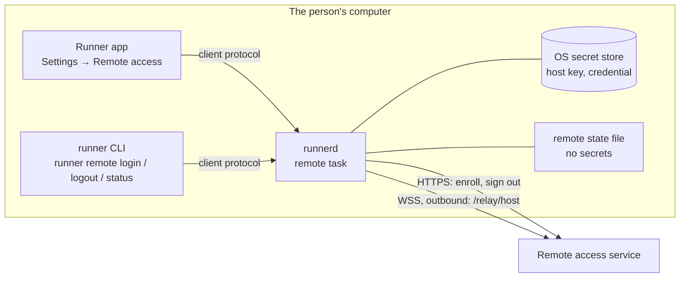

# 836 — Web remote control

> Tracking issue: [#836](https://github.com/yicheng47/runner/issues/836). Scheduling and priority live on the issue and in the [roadmap](../roadmap.md). Platforms: macOS and Windows first; Linux wherever `runnerd` runs ([#823](https://github.com/yicheng47/runner/issues/823)).
> Status: draft spec for Phase 1, connecting a host to an account. The encrypted channel, the companion protocol and terminals (Phases 2 and 3) get their sections when their development starts.
> Scope: Runner's side only, what runs on the person's computer. The web panel and the service are developed separately; this spec describes them only as far as Runner talks to them.
> Design: `design/specs/836-web-remote-control.pen`, the Settings → Remote access pane and its states, drawn and reviewed in Pencil before the app UI is built.
> Related: [#912](https://github.com/yicheng47/runner/issues/912) (iOS on the same foundation), [#808](https://github.com/yicheng47/runner/issues/808) (SSH hosts), [#838](https://github.com/yicheng47/runner/issues/838) (multi-client resize).

## Motivation

Since 0.13, agents keep running in `runnerd` after the desktop app closes, but the person still needs that desktop to see progress or unblock them. Remote control connects the computer to the person's account so they can reach the same sessions from a browser, on another network or on a phone.

## Phases

| Phase | What Runner builds |
| --- | --- |
| 1 | Connect a host: enrollment under an account, the stored secrets, the outbound connection, and its state in Settings and the CLI |
| 2 | The companion protocol v1 in `runner-core`, with golden JSON for every message, and how a host decides which clients it trusts |
| 3 | The end-to-end channel in `runnerd` (Noise through `snow`) and the adapter that serves the protocol from `runnerd`'s state: overview, live status, terminal attach, input and resize |

Phase 1 is plumbing: the web panel shows the computer online or offline. Nothing a session contains leaves the computer before Phase 3.

## Phase 1 — Connect a host



### What the person does

- **From the app.** Settings → Remote access → **Connect this computer**. Runner shows a short code and the key fingerprint, and opens the browser at the service's Add host page with the code filled in. The person approves there, after checking that the fingerprint matches. Settings then shows **Connected as @jason**, with the name the computer was given.
- **From the CLI.** `runner remote login` prints the link, the code and the fingerprint, waits for approval, then shows the approving account and asks the person to allow it. This is the path for a machine without the app, such as a Linux machine reached over ssh.
- **Pause.** The **Allow remote access** switch turns the connection off and back on without leaving the account.
- **Disconnect.** Settings → **Disconnect**, or `runner remote logout`, removes the computer from the account and deletes its local secrets.
- **Removed elsewhere.** When the computer is removed from the account, its connection closes; Settings says it was removed and offers **Connect again**.

In every case the agents keep running. Remote access never stops, restarts or replaces `runnerd` or its sessions, and a failure in it never takes the daemon down.

### Who may connect a host

Connecting a host to an account is the most sensitive action in this feature: from Phase 3 on, whoever holds the account can type into this computer's terminals. Runner's agents run as the same user, can run the `runner` CLI, and can be steered by text they read. An agent that connected the computer to someone else's account, after a prompt injection or by mistake, would hand that account a shell. Rules:

- **The person starts it.** From the app, the click on Connect is the person's consent. `runner remote login` requires an interactive terminal (stdin and stdout are TTYs, which an agent's command tool does not provide), and refuses when `RUNNER_HANDLE` is set, which Runner sets for every agent session it starts.
- **The person confirms the account.** The approval in the browser happens under whatever account approved it. Before `runnerd` saves the credential for connection, the CLI shows the approving account (`@jason · Jason`) and asks to allow it; a refusal follows the sign-out cleanup path, including storing the credential solely for pending revocation if needed. The app flow shows the account in the Connected state with Disconnect beside it.
- **Not through the generic call.** The remote requests are not reachable through `runner call`, so no tool table exposes them.
- **The limit, stated plainly.** Any program running as the user can do what the user can, including reading files. These rules stop an agent from connecting the computer through Runner's own paths or by mistake; they are not a sandbox.

### Secrets on the host

The host holds two long-lived secrets: the private half of its key and the credential the service issues at enrollment. The device code is a third, but it lives only in `runnerd`'s memory while enrollment or recovery of the approved response is pending, bounded by the enrollment or claim deadline. The private key never leaves the computer; the credential is sent only to the service, in the `Authorization` header over TLS.

- **Storage.** The operating system's secret store (Platforms has the details): the macOS Keychain, Windows Credential Manager, or the Secret Service on Linux, with an owner-only (`0600`) file in Runner's app-data directory only where no secret store is running, the usual case on a headless machine reached over ssh. Development builds use their own entries, so `make run` never touches the installed app's enrollment.
- **Nowhere else.** Never in Runner's SQLite database, settings, logs, crash reports or any export; never printed by the CLI after enrollment; never served through `runnerd`'s client protocol to the app or the CLI; never in an environment variable, because every agent and shell `runnerd` starts inherits its environment.
- **Agents run as the same user.** A Windows credential, a Secret Service item without a lock, or an owner-only file is readable by any process of that user, an agent included. The macOS Keychain is not: another program's read raises a prompt the person sees. The Keychain is therefore required on macOS; elsewhere Runner uses the best store available, and nothing in Runner points an agent at the secrets.
- **Transport.** HTTPS and WSS with certificate verification against the system's trust store, with no option to turn it off. The only exception is a development service on `http://localhost`, and only when that origin is given explicitly.
- **Recovery.** Removing the host from the account, or a completed `SignOutHost`, invalidates the credential at once. Offline logout closes local access immediately and keeps server revocation explicitly pending until the service is reachable. A new enrollment always generates a fresh key; pause/resume, network reconnects and retries within an enrollment reuse its current key. A suspected leak requires server revocation, which can also be requested from another browser.
- **What the key will protect.** From Phase 3 the private key authenticates the host to browsers over the end-to-end channel. Noise mixes a fresh ephemeral key into every session, so a stolen host key does not decrypt sessions recorded earlier; it does let its holder pose as the host from then on.

### Talking to the service

What Runner sends and how it reacts. A released Runner speaks this, so a change to it is compatible (new optional fields, new message types, new close codes) or goes into a new path version.

#### Calls

- The service is one HTTPS origin, written `https://runner.example` below; the default origin and the `--server` override are an open question.
- Calls are [Connect](https://connectrpc.com/docs/protocol/) unary calls in JSON: `POST <origin>/api/runner_server.v1.HostEnrollmentService/<Method>` with `Content-Type: application/json`. `reqwest` and `serde` are enough; no protobuf or Connect library is needed.
- JSON follows the protobuf JSON mapping: lowerCamelCase field names, 64-bit integers such as `hostId` as decimal **strings**, `bytes` as standard base64 with padding, enums by their full names. Missing fields take their defaults, and unknown fields are ignored.
- A failure is a non-200 status with `{"code": "...", "message": "..."}`. Runner acts on `code` alone: `invalid_argument` shows the message and stops; `resource_exhausted` backs off; `unauthenticated` on a credential call means the credential is no longer valid; `unavailable`, `internal`, `unknown` and network errors are retried with backoff.

#### Host identity

- **Host key.** A fresh X25519 key pair for each new enrollment, generated from the operating system's secure random source with the same library Phase 3 uses for Noise, so the key is valid for the channel. Only the 32-byte public half is sent, at enrollment. A new key means enrolling again. Phase 2 confirms the key type before Phase 1 ships.
- **Fingerprint.** The lowercase hex of the first 10 bytes of SHA-256 over the 32 raw public-key bytes, in five groups of four separated by spaces, shown by Runner at enrollment so the person can compare it with the web panel. Golden vector: key bytes `00 01 02 … 1f` (base64 `AAECAwQFBgcICQoLDA0ODxAREhMUFRYXGBkaGxwdHh8=`) have fingerprint `630d cd29 66c4 3366 9112`.
- **Host info.** Sent at enrollment and in `hello` on every connection:

| Field | Rule | Runner reports |
| --- | --- | --- |
| `hostname` | 1–255 bytes | The OS host name, such as `jason-mac-studio` |
| `platform` | `macos`, `windows` or `linux` | From `std::env::consts::OS` |
| `arch` | 1–16 characters of `a-z0-9_` | `arm64` for `aarch64`, `x86_64` for `x86_64` |
| `osVersion` | 1–64 bytes | `macOS 15.4` (`kern.osproductversion`), `Windows 11 24H2` (the registry's product name and `DisplayVersion`), or `PRETTY_NAME` from `/etc/os-release` |
| `runnerVersion` | 1–32 bytes | Runner's version, such as `0.18.2` |

#### Enrollment

A device-code flow in the style of [RFC 8628](https://www.rfc-editor.org/rfc/rfc8628).

**`StartEnrollment`**, no authentication:

```json
{
  "host": {"hostname": "jason-mac-studio", "platform": "macos", "arch": "arm64", "osVersion": "macOS 15.4", "runnerVersion": "0.18.2"},
  "hostKey": "AAECAwQFBgcICQoLDA0ODxAREhMUFRYXGBkaGxwdHh8="
}
```

```json
{
  "deviceCode": "pV8m2Qy1nX0bJk3sTq7wE5rLc9aZ4hUd6gFiYoN1MjA",
  "userCode": "BCDF-GHJK",
  "verificationUri": "https://runner.example/hosts/add",
  "verificationUriComplete": "https://runner.example/hosts/add?code=BCDF-GHJK",
  "expiresIn": 600,
  "interval": 5
}
```

Runner keeps `deviceCode` in memory only, never shows or logs it, and shows `userCode`, the links, the fingerprint and the time left (`expiresIn` seconds).

**`PollEnrollment`**, no authentication, every `interval` seconds with `{"deviceCode": "..."}`:

| `state` | Runner |
| --- | --- |
| `ENROLLMENT_STATE_PENDING` | keeps polling |
| `ENROLLMENT_STATE_DENIED` | stops: Stopped, denied |
| `ENROLLMENT_STATE_EXPIRED` | stops: Stopped, expired |
| `ENROLLMENT_STATE_APPROVED` | confirms the account where required, stores the secrets and connects |

```json
{
  "state": "ENROLLMENT_STATE_APPROVED",
  "hostId": "7383920468475904",
  "credential": "rhc_Zm9vYmFyYmF6cXV4cXV1eGNvcmdlZ3JhdWx0Z2FycGx",
  "relayUrl": "wss://runner.example/relay/host",
  "account": {"username": "jason", "displayName": "Jason"},
  "claimExpiresAt": "2026-10-16T10:10:00Z"
}
```

The approved response is recoverable: after a transient failure, retry `PollEnrollment` with the same in-memory device code. Before `claimExpiresAt`, retries return the same host id, credential and deadline and never create another host or extend the deadline. `claimExpiresAt` is an RFC 3339 UTC timestamp, fixed on the first claim to the later of the enrollment expiry and two minutes after the claim. Account confirmation and the first authenticated `hello` must finish before it; otherwise the provisional credential expires and the service cleans up the unconnected host. An expired or revoked claim returns `ENROLLMENT_STATE_EXPIRED`; start again only then. An inactive approving account also expires the claim. On `resource_exhausted`, Runner adds 5 s to its interval. Discard the device code once the approved result is safely stored, refused or expired.

#### Credential

`rhc_` followed by 43 base64url characters. Runner stores it as Secrets on the host describes, sends it only as `Authorization: Bearer <credential>` on the `/relay/host` upgrade and on `SignOutHost`, never in a URL, and redacts anything with the `rhc_` prefix from its logs.

#### The host connection: `/relay/host`

`runnerd` keeps one WebSocket to `relayUrl` while remote access is on, with `Authorization: Bearer <credential>` and `Sec-WebSocket-Protocol: runner-relay.v1` on the upgrade. Phase 3 adds session traffic to it.

| Before the upgrade | Runner |
| --- | --- |
| 400 `unsupported_protocol` | stops: Stopped, update required |
| 401 `unauthenticated` | stops: Stopped, removed or account inactive |
| 429 `rate_limited` | retries after `Retry-After` seconds |
| 503 or a network error | retries with backoff |

**Messages** are text frames, each one JSON object of at most 64 KiB with a `type`; unknown types and fields are ignored. Within 10 seconds of the upgrade Runner sends `hello`, and the service answers `welcome`, whose `name` Settings shows:

```json
{"type": "hello", "host": {"hostname": "jason-mac-studio", "platform": "macos", "arch": "arm64", "osVersion": "macOS 15.4", "runnerVersion": "0.18.2"}}
{"type": "welcome", "hostId": "7383920468475904", "name": "Mac Studio", "account": {"username": "jason", "displayName": "Jason"}}
```

**Heartbeat.** The service pings every 25 seconds and Runner answers with a pong. Runner treats 75 seconds without any frame from the service as a dead connection and reconnects. The service marks a host offline after 60 seconds without receiving anything; this is temporary connectivity loss, never credential revocation or a reason to stop local sessions.

| Close code | Meaning | Runner |
| --- | --- | --- |
| 1001 (sent by Runner) | `runnerd` is stopping, or remote access was paused | — |
| 1008 | protocol violation | logs it, reconnects with backoff |
| 1011 | service error | reconnects with backoff |
| 1012 | service restart | reconnects after a random 1–10 s |
| 4001 | another connection used the same credential | stops: Stopped, in use elsewhere |
| 4003 | removed, signed out, or the account was deactivated | stops: Stopped, removed |

**Backoff** is exponential with full jitter: a random delay up to 1 s, then up to 2, 4 and so on, capped at 60 s, reset once a connection has stayed past `welcome` for 60 seconds.

#### Signing out: `SignOutHost`

`runner remote logout` and Disconnect first persist `revocation_pending` with remote access disabled, close the local WebSocket and delete the private key, even without a network. They then call `SignOutHost` with `Authorization: Bearer <credential>` and body `{}`. Sign-out accepts a valid credential even if the owner is inactive or the first-connection deadline expired. For this call, `unauthenticated` means the credential no longer identifies an existing host; success or `unauthenticated` both complete revocation. Runner deletes the remaining credential and clears the pending state.

A transient failure enters `revocation_pending`: **Disconnected locally — removal from account pending**. Keep only the credential in the OS secret store for retrying `SignOutHost` with the normal backoff; never use it to reconnect. Persist this state across daemon restarts, expose Retry now, and block a new enrollment or server change until revocation completes. Removing the host in the web panel lets the next retry complete with `unauthenticated`. The CLI reports pending removal and exits non-zero. Refusing the approving account follows the same cleanup path; if revocation fails, persist the credential solely for cleanup.

Pause keeps the key and credential for resuming the same enrollment. Logout or removal retires the key; a new enrollment never reuses it.

### `runnerd`

- **A `remote` module** in `runner-daemon`, one task on the daemon's Tokio runtime. It owns the state below, the enrollment calls (`reqwest`, already a daemon dependency, with `rustls-tls-native-roots`) and the WebSocket (`tokio-tungstenite` with rustls and the same native roots). Wire types (host info, requests, responses, control messages, close codes) live in `runner-core`, so the CLI and tests share them.
- **State.** `off`, `enrolling` (code, fingerprint, links, expiry), `confirming` (the approving account, CLI flow only), `connecting`, `connected` (since, account, host name), `reconnecting` (attempt, last error, next retry), `paused`, `revocation_pending`, and `stopped` (reason: removed, in use elsewhere, update required, denied, expired). One enrollment at a time; starting another cancels the first.
- **Persisted state.** The origin, host id, relay URL, account username and display name, host name, the paused flag and pending-revocation flag, in a small file in `runnerd`'s app-data directory. No secret is in it. The secrets are in the secret store, keyed by origin.
- **Start-up.** If revocation is pending, retry only `SignOutHost`; never reconnect or load a private key for that enrollment. Otherwise, when enrolled and not paused, `runnerd` loads the secrets and connects. If the secrets are missing (deleted by hand, a new user profile), it stops with reason removed instead of retrying.
- **Shutdown and updates.** Stopping the daemon closes the connection with 1001. An app update restarts `runnerd`, and the connection comes back with it.
- **Proxies.** The enrollment calls follow the system proxy as `reqwest` does; the WebSocket should take the same route (open question).
- **Logs.** `runnerd.log` records state changes, HTTP statuses and close codes. It never records the device code, the credential or key material.

### Client protocol

New requests on `runnerd`'s client protocol, for the app and the CLI:

| Request | Result |
| --- | --- |
| `remote_status` | The status snapshot |
| `remote_enroll_start { origin?, confirm_account }` | Starts enrollment; returns the code, fingerprint, links and expiry. The CLI sets `confirm_account`; the app does not. |
| `remote_enroll_confirm { allow }` | Answers `confirming`. A refusal follows the sign-out cleanup path, retaining the credential only for pending revocation. |
| `remote_enroll_cancel` | Cancels a pending enrollment |
| `remote_set_paused { paused }` | Pauses or resumes the connection |
| `remote_logout` | Disables access immediately; returns completed removal or pending server revocation |

A pushed `remote_status_changed` event carries the snapshot whenever it changes: the state and its details, the origin, the account, the host name and id, `connected_since`, the last error and the next retry. No secret is ever in it. These requests are left out of the tool table that `runner call` reaches.

### CLI

- `runner remote login [--server <origin>]`: prints the verification link, the code, the fingerprint and the time left; waits; then shows the account and asks `Allow remote access to this computer from @jason (Jason)? [y/N]`. Refused without a TTY or inside an agent session, with a message pointing to Settings → Remote access. Exits non-zero on denial, expiry or refusal.
- `runner remote logout`: disables access immediately, then revokes the credential and deletes it; reports pending removal and exits non-zero if the service cannot yet confirm revocation.
- `runner remote status [--json]`: the state, account, host name, origin and connection time.
- `runner help` lists the three commands; the user guide's CLI reference picks them up from it ([#809](https://github.com/yicheng47/runner/issues/809)).

### Desktop app

A new Settings section, **Remote access**, after Notifications, designed in Pencil before it is built:

| State | Shows | Actions |
| --- | --- | --- |
| Not connected | What remote access does, and that sessions are encrypted end to end once session access ships | **Connect this computer**; the service origin under Advanced |
| Waiting for approval | The code, large and monospaced; the fingerprint; the link; the time left | **Open in browser**, **Copy link**, **Cancel** |
| Connected | `@jason · Jason`, the host's name, connected since | **Allow remote access** switch, **Disconnect** |
| Reconnecting | The last error and the next retry | **Retry now** |
| Paused | Remote access is off for this computer | The switch |
| Revocation pending | Disconnected locally; removal from the account is pending | **Retry now**; explain removal from another browser; Connect and server changes stay disabled |
| Stopped | Why: removed from the account, in use elsewhere, Runner needs an update, denied, or expired | **Connect again**, or **Check for updates** |

Disconnect asks for confirmation: it removes the computer from the account and has to be redone with a new code. When the connection stops for a reason the person did not cause (removed, in use elsewhere, update required), Runner shows a toast with a link to the pane.

### Platforms

- **macOS.** Keychain generic-password items under the service `com.wycstudios.runner.remote` (development builds `com.wycstudios.runner-dev.remote`), one per origin, created by the signed `runner` binary so later reads by Runner's own binaries need no prompt. The items stay in the login keychain on this Mac: they are not marked synchronizable, so iCloud Keychain does not carry them to another Mac. `security-framework` is already in the dependency tree.
- **Windows.** Generic credentials in Credential Manager, targeted `com.wycstudios.runner.remote/<origin>`, persisted per machine rather than roaming with the profile.
- **Linux.** The Secret Service over D-Bus when one is running; otherwise `remote-secrets` in the app-data directory with mode `0600`, created with that mode rather than changed after.

### Out of scope

Everything in Phases 2 and 3; push notifications and the iOS app ([#912](https://github.com/yicheng47/runner/issues/912)); LAN, Bonjour and Tailscale routes; one computer on several accounts or services at once; credential rotation; starting, stopping or archiving sessions remotely.

### Verification

- Unit tests: host info normalization on each platform, the fingerprint against the golden vector, the state machine with a fake clock (backoff bounds and reset, every close code and refusal status mapped to its next state), and a secret-store round trip on macOS and Windows CI.
- Wire fixtures: every JSON example above as a golden file, parsed and produced by the `runner-core` types.
- Integration tests against a fake service in the test suite, a small Tokio server that answers the calls and the WebSocket as above: enrollment from the app path and the CLI path (allow and refuse), denial, expiry, `resource_exhausted`, lost approved response followed by the same claim, claim deadline before first `hello`, approval then `welcome`, a missed heartbeat, 1012 with jitter, 4001, 4003, a 401 on reconnect, logout, offline logout with pending revocation surviving restart and completing once the service returns, refusal with failed revocation, pause/resume retaining the key, and a daemon restart that reconnects. Re-enrollment after removal/logout has a new fingerprint; a pending revocation never opens a host WebSocket. A failure in the remote task leaves sessions running in every case.
- The agent rules: `runner remote login` refused with `RUNNER_HANDLE` set and without a TTY, and the remote requests absent from `runner call`.
- Live, against a running instance of the service: connect the Mac and the Windows PC from the app and a third machine from the CLI; see each online; pause and resume; disconnect offline, restart the development daemon and verify no reconnect, restore the network and finish revocation, then enroll with a fresh fingerprint; remove one from the account and see Stopped, removed; confirm on macOS that the Keychain prompts when another program reads the item. Each run is recorded with Runner's version and platform.

### Open questions

| Question | Recommendation | Settle before |
| --- | --- | --- |
| The default service origin | Default to the hosted service's origin, with `--server` and the Advanced field for others | Phase 1 ships |
| WebSocket through a proxy | Follow the system proxy like `reqwest`, using HTTP `CONNECT`; many people in mainland China run one | Phase 1 implementation |
| Is the host key an X25519 Noise static key? | Yes, generated by `snow`; Phase 2 confirms it, since enrolled hosts would otherwise enroll again | Phase 1 ships |
| Should the app also confirm enrollments started from the CLI when it is running? | Not in Phase 1: the TTY and account confirmation cover the CLI; revisit with Phase 3's client trust | Phase 2 |
