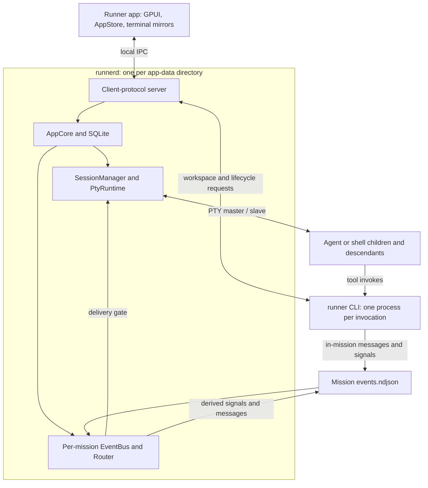
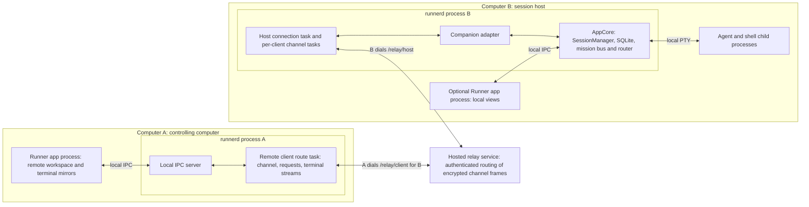
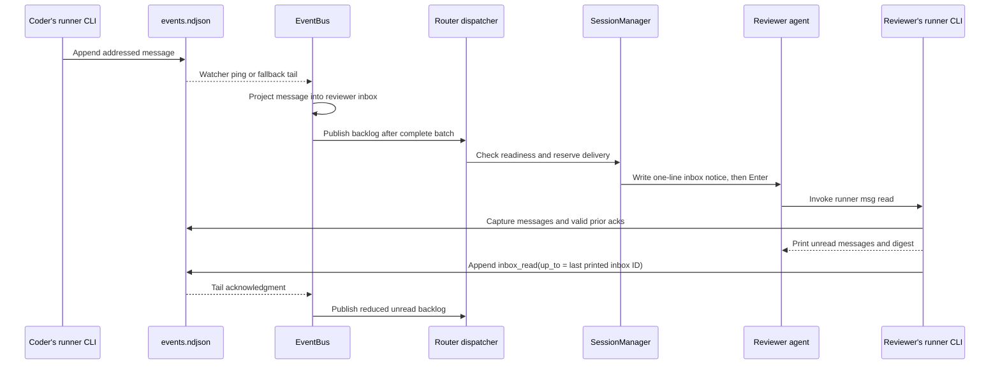

# runnerd, sessions, and mission routing: a code walkthrough

Checked against Runner `nightly-remote` at `cbb877c4b992` on 2026-10-24. This continues the [runtime adapter walkthrough](runtime-adapters.md): adapters describe how to integrate an agent; this note follows the service that owns its process, the manager that tracks its session, and the router that delivers mission notifications. The [process model](../arch/process-model.md), [concurrency reference](../arch/concurrency.md), and [architecture](../arch/arch.md) remain the broader references. The remote process model is included below; encryption and transport details are covered in [remote control](remote-control.md).

The central ownership rule is that **runnerd owns the running work**. The desktop app is a client that displays it. A mission groups sessions and has a log, bus, and router inside the daemon. Each live session has an agent or shell process connected to a PTY. Closing a client connection does not end that work.

For a focused walkthrough of the current message path, including the readiness gate, notification attempts, read acknowledgments and debugging pointers, see [Mission message delivery](./mission-message-delivery.md).

## 1. Where the application core lives

“Core” has two meanings in this repository. The `runner-core` crate contains shared types, protocol contracts, event-log primitives, and daemon connection/launch support. The application core that executes operations lives in `runner-daemon`.

| Layer | Responsibility | Start reading |
| --- | --- | --- |
| `runner-core` | Shared domain and wire types, durable log reader/writer, client transport and daemon launcher. | [`protocol/`](../../crates/runner-core/src/protocol/), [`event_log/`](../../crates/runner-core/src/event_log/) |
| `AppCore` | Shared handles to the database, session manager, mission buses/routers, event channel, and other daemon services. Cloning it shares those services. | [`runner-daemon/src/lib.rs`](../../crates/runner-daemon/src/lib.rs) |
| `ops` | Application operations: start a mission, resume a session, post a message, archive, etc. | [`ops/mission.rs`](../../crates/runner-daemon/src/ops/mission.rs), [`ops/session.rs`](../../crates/runner-daemon/src/ops/session.rs) |
| `repo` | Database row mapping and persistence operations. | [`repo/session.rs`](../../crates/runner-daemon/src/repo/session.rs), [`repo/mission.rs`](../../crates/runner-daemon/src/repo/mission.rs) |
| `SessionManager` | Session creation/resume/stop, state reduction, terminal ownership, and input coordination. | [`session/manager/mod.rs`](../../crates/runner-daemon/src/session/manager/mod.rs) |
| `PtyRuntime` | PTY and child-process handles, byte IO, process supervision, and runtime output workers. | [`session/pty_runtime.rs`](../../crates/runner-daemon/src/session/pty_runtime.rs) |
| `EventBus` and `Router` | Tail the mission log, project inboxes, handle coordination signals, and schedule terminal notices. | [`event_bus/mod.rs`](../../crates/runner-daemon/src/event_bus/mod.rs), [`router/mod.rs`](../../crates/runner-daemon/src/router/mod.rs) |

An `AppCore` is shared state, not a single serialized event loop. Socket requests, session workers, and mission workers can reach it concurrently. The locks and channels below establish the smaller ordering boundaries.

## 2. runnerd's process model

### Processes and lifetime

There is one daemon per app-data directory, with separate production and development instances. Multiple desktop windows share the app's connection and terminal mirror registry. Missions do not get separate daemon processes; their sessions are children managed by the same daemon.



The arrows describe communication and ownership, not a strict OS parent tree. For example, an agent can launch a short-lived `runner msg post` child, while the daemon itself may originally have been launched by the desktop app or an external CLI.

The daemon is shipped through the CLI binary. [`runner-cli/src/main.rs`](../../crates/runner-cli/src/main.rs) checks the executable's file stem: `runnerd` enters `runner_daemon::daemon::server::run`; `runner` enters command dispatch. Sharing a binary does not mean sharing a process.

[`Launch::spawn`](../../crates/runner-core/src/daemon_process.rs) starts the service with explicit data/log/endpoint paths and null standard IO. On Unix it calls `setsid` before exec. Windows uses a hidden process with a new process group and requests job breakaway; an app launch can retry without breakaway if that request is denied. This is an app/CLI-launched background process, rather than a per-mission shell wrapper. It keeps serving even with no clients and no live sessions.

The local transport is an owner-only Unix-domain socket or Windows named pipe. Typed request/response frames, pushed application events, and terminal frames share this connection. [`server.rs`](../../crates/runner-daemon/src/daemon/server.rs) dispatches ordinary requests through blocking workers; terminal input has its own ordered session queue. A disconnected client loses its attachments and window registrations, while the session processes remain owned by runnerd.

### With remote control enabled

Suppose computer A controls a mission running on computer B. **B's runnerd still owns the mission, its SQLite rows and event log, its terminal models, and every agent process.** A's desktop app reaches B through A's own runnerd and the hosted relay. Enabling remote access adds networking tasks to the existing daemon; it does not launch a second local daemon for remote sessions.



Both WebSocket connections are initiated outbound and carry traffic in both directions. B keeps its host connection while remote access is active. A opens a client route for the selected host; multiple panes and mission requests share that route. The host connection multiplexes channels from remote clients, and each channel can carry several terminal streams. Opening another remote pane therefore does not imply another agent process, daemon, or WebSocket.

“Client” and “host” are roles in this connection, not different daemon binaries. The same runnerd can host its own sessions and control another computer. A may consequently have its own host connection in addition to the A-to-B client route shown here. Pausing this computer's hosting leaves it signed in for outbound client use; the client-side `signed_in` check accepts `RemoteState::Paused`.

The relay is a separately deployed service. It authenticates routing, assigns channels, forwards bounded encrypted frames, and closes routes. The paired endpoints hold the end-to-end channel keys. Agent execution, terminal parsing, session persistence, and mission message routing stay on B. A remote Start or Resume action runs B's application operations and creates or resumes the process there.

This topology is implemented in the checked revision, including [`remote/client/`](../../crates/runner-daemon/src/remote/client/) and the desktop [`surfaces/remote_client/`](../../crates/runner-app/src/surfaces/remote_client/). The older remote-control note's description of the client as *proposed* belongs to its earlier revision. Code names such as `BrowserPair`, `Controller::Browser`, and `browser_resize` refer to the remote Runner client in this implementation.

#### Where the extra work runs

[`serve_with_listener`](../../crates/runner-daemon/src/daemon/server.rs) calls `remote::spawn` inside the daemon's existing Tokio runtime and connects the companion adapter to `AppCore` through a weak reference. The networking subsystem has its own task supervision, so a failed host networking task can restart without restarting sessions.

| Component | Runs in | Owns |
| --- | --- | --- |
| Host connection state machine | Tokio tasks in B's runnerd, [`remote/mod.rs`](../../crates/runner-daemon/src/remote/mod.rs) and [`machine.rs`](../../crates/runner-daemon/src/remote/machine.rs) | Enrollment/pause state, host WebSocket, heartbeats, retry deadlines, and channel registry. |
| Host channel and companion adapter | One channel task in B's runnerd, [`channels.rs`](../../crates/runner-daemon/src/remote/channels.rs) and [`companion/mod.rs`](../../crates/runner-daemon/src/companion/mod.rs) | Handshake, encrypted records, request dispatch, overview/feed subscriptions, terminal attachments, and controller lease. Synchronous core calls use blocking workers; attached terminal streams have forwarding threads. |
| Client route | Tokio task in A's runnerd, [`client/route.rs`](../../crates/runner-daemon/src/remote/client/route.rs) | One target-host connection, request IDs, channel generation, reconnect, and shared subscriptions. |
| Client terminal streams | A's runnerd, [`client/terminal.rs`](../../crates/runner-daemon/src/remote/client/terminal.rs) | Snapshot assembly, sequence checks, bounded replay/attachment queues, and conversion to the ordinary terminal-frame interface. |
| Remote terminal presentation | A's app, [`remote_client/transport.rs`](../../crates/runner-app/src/surfaces/remote_client/transport.rs) | Local mirrors and input encoding using a transport wrapper over its own daemon client. |

A's remote terminal streams are transport state. They are not local `SessionManager` children or copies of B's authoritative terminal model. B's normal PTY readers, forwarders, reducer and delivery gates remain the execution path. The host adapter's [`DaemonCore`](../../crates/runner-daemon/src/companion/core.rs) reaches those existing services through a narrow interface.

#### Input, output, and mission messages across the boundary

For one remote keystroke, A's app encodes input and sends it over local IPC to A's daemon. The client route packages a companion `input` message, encrypts it, and sends it through the relay. B's channel decrypts it; the companion adapter records input observations and calls `SessionManager::queue_terminal_input`. From there it follows the same ordered input worker and delivery gate as typing on B's desktop. A remote human draft can therefore hold back a mission inbox notice.

Output takes the reverse path from B's authoritative terminal: attach snapshot and numbered frames → companion messages → encrypted channel → A's daemon's terminal subscription → A's app mirror. B continues parsing output and answering terminal queries with no desktop attached on either side. B's local app, when open, is another viewer of that same terminal.

A PTY still has one size. The host records its controller as Desktop, a remote channel, or None. Remote viewport changes apply through that controller rule, and all viewers adopt the host's ordered resize frames. Detaching the controlling remote channel releases its lease to None and preserves the last size; the host desktop can explicitly take control back. Taking control changes terminal presentation ownership, not ownership of the child process.

Remote mission Post and Answer requests also execute on B, append to B's mission log, and enter B's existing inbox/router path. Agent-to-agent messages within that mission remain local log writes and local router delivery. A mission and its members remain owned by one host daemon; the relay carries the operator's view and commands.

#### Disconnects and recovery

| Event | Connection/view effect | Effect on B's agents and mission router |
| --- | --- | --- |
| A closes a remote pane or disconnects its app | Release its terminal attachment and app-owned overview subscriptions; a shared route may remain for other consumers. | Continue running. |
| Relay or network disconnects | Drop affected channels and controller leases. Host/client networking retries; a retained client terminal stream reattaches with a fresh snapshot and `IfFree` control. | Continue running while B's daemon stays alive. |
| B pauses remote access | Close the host connection and its client channels; retain enrollment for later unpause. | Continue locally. |
| A's runnerd stops or crashes | A's remote routes disappear. A later client connection must rebuild its views. | B continues running. |
| B's app quits with Keep | B's daemon and remote host connection remain available. | Continue running. |
| B's runnerd stops or crashes | Host becomes unavailable. | Follow the local daemon shutdown/crash behavior below; reconnecting from A cannot recover the old PTY. |

Reconnect is transport recovery. The client route rejects input while unready and uses a channel generation to discard input queued for a previous connection. Pending commands fail on route loss and are not automatically replayed; a command whose response was lost may already have executed on B, so inspect the refreshed host state before retrying a mutation. Retained terminal streams reattach, while mission feed subscriptions must be refreshed/followed again. An unused connected route closes after 60 seconds when it has no overview followers, feeds, terminal streams, or pending requests.

The host adapter drops terminal subscriptions and releases the channel's controller lease on channel teardown; that cleanup does not call session Stop. Bounded terminal queues and encrypted-record credit keep a slow viewer's backlog separate from PTY execution. These are the boundaries that let remote control disappear while the mission continues.

### Startup and replacement

Follow [`daemon_process.rs`](../../crates/runner-core/src/daemon_process.rs), then [`daemon/server.rs`](../../crates/runner-daemon/src/daemon/server.rs) and [`daemon/boot.rs`](../../crates/runner-daemon/src/daemon/boot.rs):

1. The client first tries the existing endpoint. The handshake includes an executable hash so the app can distinguish a matching daemon from an older build.
2. If a start or replacement is needed, a startup lock serializes competing starters. The client checks the endpoint again after taking the lock. An app can stop and replace a mismatched daemon; the CLI does not take over that replacement path.
3. The new daemon takes a separate lifetime lock for its data directory. A duplicate daemon that cannot acquire it exits. Startup installs logging and builds the application core.
4. Boot opens/migrates SQLite, creates `PtyRuntime` and `SessionManager`, starts runtime watchers, converts legacy mission rosters where needed, and mounts routers for running missions. It then demotes stale running session rows and performs orphan cleanup. This reconstructs mission coordination; it does not reconnect to an old PTY.
5. The server creates its Tokio runtime and binds IPC. It configures the hook endpoint, starts background services, and consumes eligible launch-resume claims while accepting clients.

The starter retains the child handle while retrying the connection, so an early process exit is reported immediately. A live daemon has a 60-second startup budget. Lifecycle budgets are centralized in `runner-core::daemon_process`.

The server also binds an accept-and-close sentinel at the older MCP endpoint. It periodically checks ownership of both endpoints and shuts down if either has been replaced. The sentinel is compatibility protection against an older app becoming another database owner; it is not the current workspace API.

### Threads and async tasks

The process contains both Tokio tasks and ordinary OS threads. The PTY API is blocking, so a session's blocking reader is not run on the IPC executor.

| Scope | Main workers | Ordering boundary |
| --- | --- | --- |
| Daemon | `runner-ipc` Tokio runtime, connection tasks, blocking request workers, discovery/usage/other services. | IPC frames and request IDs; requests can execute concurrently. |
| Live session | `pty-reader-…`, `pty-idle-…`, manager forwarder, terminal-event workers, and ordered terminal-input worker. | Runtime output channel, per-session state lock, delivery gate, PTY writer mutex. |
| Mounted mission | `notify` watcher, `event-bus-…` consumer, and `mission-dispatch` driver. | Log byte order, complete projection batches, dispatcher input channel and deadlines. |
| Remote control | Host connection/channel tasks and client route tasks on `runner-ipc`, plus attachment forwarders and blocking adapter calls. | Channel generations, request IDs, terminal sequence numbers, and bounded queues. Session execution stays on the host. |
| Startup/lifecycle work | Background spawn batches, conversation-key capture, resize settlement, resume and teardown helpers as needed. | Cancellation flags, launch identity, resume claims, and shutdown gate. |

This is a map of responsibilities, not an exact fixed thread count. A watcher or terminal model can have additional workers, and each attached terminal needs stream forwarding. There is no thread or process dedicated to “the lead” beyond the same session machinery every other member uses.

The session map is `Mutex<HashMap<String, Arc<Mutex<SessionState>>>>`. The outer mutex protects membership; each session has its own mutex for mutable state. Code clones the state handle and releases the map lock before locking that session. One busy terminal therefore does not require holding a daemon-wide session lock while its output is parsed.

### What happens when something closes

| Action | Session processes | Mission coordination |
| --- | --- | --- |
| Detach a terminal / disconnect the app / quit with Keep | Continue in runnerd. A later attach gets the current terminal snapshot. | Bus and router continue. |
| Stop one session | Stop and reap that process tree; persist its exit. | Other members keep running; its unread backlog remains. |
| Stop a mission | Cancel queued spawns and stop its live session processes. | Mission row stays `running`; bus and router remain mounted. |
| Archive a mission | Stop its sessions and close its drawer shells. | Complete/archive the mission, append `mission_stopped` for a running mission, unmount bus/router. |
| Graceful daemon stop or app quit with Stop | Stamp eligible running sessions for launch resume, then stop children and drain workers. | In-memory workers end; persisted rows and logs remain. |
| Daemon crash | Existing PTYs cannot be reattached by a new daemon. Startup reconciles stale rows and possible orphans. | Rebuild projections from logs when the daemon starts again. |

Normal resume claims come from a deliberate shutdown stamp. A crash does not imply that every previously running agent should be restarted automatically. [`daemon/resume.rs`](../../crates/runner-daemon/src/daemon/resume.rs) consumes persisted claims, respects the chat resume setting and drawer exclusions, and reports successful resumes and errors. Launch resume is stricter than manual resume about silently starting a fresh conversation.

On Unix, explicit PTY stop uses a hangup/grace period followed by process-group termination as needed and cleanup of captured descendants. Windows owns agent trees through kill-on-close jobs. [`session/process/`](../../crates/runner-daemon/src/session/process/) contains the platform operations. After a crash, the Unix orphan sweep checks the recorded PID's command identity before signaling; Windows clears stale PIDs because the previous process's job handles have closed. See the [process-model reference](../arch/process-model.md#lifecycle) for Windows end-session stamping and the desktop client's bounded recovery policy.

## 3. What a session consists of

A Runner session is a persistent identity that can host several successive process launches. Resume keeps the Runner session ID but starts a new process. The agent's native conversation ID is a separate value, `agent_session_key`.

| State | Location | Lifetime and purpose |
| --- | --- | --- |
| Session row | SQLite, through `repo::session` | ID, mission/slot/role links where applicable, runtime, cwd, launch definition, conversation key, lifecycle, geometry, PID/command metadata, and resume eligibility. Survives daemon exit. |
| `SessionState` | `SessionManager.sessions` | Current model, optional live handle, pending-spawn/resume flags, terminal, subscribers, input queue, resize state, and delivery gate. Daemon memory. |
| Manager `SessionHandle` | Inside `SessionState` | Runtime token, mission/role identity, startup hold, forwarder handle, and cancellation flag for the current launch. |
| PTY runtime handle | `PtyRuntime.sessions` | Actual PTY master/writer, child handle, process-tree supervision, detector, and exit state. There is another private `SessionHandle` type here. |
| Agent conversation | Agent-managed files/storage | The conversation the adapter may restore using `agent_session_key`. Runner's terminal grid is not that conversation. |

The two `SessionHandle` types are easy to confuse. The manager's handle coordinates application behavior; the PTY layer's handle owns operating-system resources. [`SessionRuntime`](../../crates/runner-daemon/src/session/runtime.rs) is the interface between them. Its `RuntimeSession` token identifies a process hosted by that implementation; `SpawnSpec` carries prepared launch inputs so the PTY layer does not need to query SQLite.

There are also several meanings of “state”:

- The persisted session lifecycle says running, stopped, or crashed. During two-phase mission launch a row can already say running while its PTY is still pending.
- `SessionModel` reduces runtime observations, local input, drafts, lifecycle and conversation-key events into the current `AgentStatus` and effects. Busy/idle is activity, not proof that the process exists or that a task is finished.
- Delivery readiness asks whether it is safe to type a router notice into this session now. A live, busy agent can be delivery-ready; an idle agent with a human draft can be blocked.
- A mission's `running` status means the mission remains active. It can have zero live PTYs, including after Stop or in an empty mission.

Direct chats use the same session and terminal machinery, with no mission router or inbox. Their handle can label the process without making it a mission participant. The bundled CLI is still on their PATH; mission identity requires the mission environment, not merely a handle.

### Starting a mission: register first, spawn second

Read `mission_start_impl_with_size` in [`ops/mission.rs`](../../crates/runner-daemon/src/ops/mission.rs), then `register_mission_session` and `complete_mission_session_spawn` in [`manager/spawn.rs`](../../crates/runner-daemon/src/session/manager/spawn.rs).

```mermaid
sequenceDiagram
    participant Client
    participant Ops as Mission operations
    participant SM as SessionManager
    participant Bus as Bus and router
    participant Worker as Spawn worker
    participant PTY as PtyRuntime
    Client->>Ops: Start mission
    Ops->>Ops: Persist mission, roster and opening events
    loop Each roster member
        Ops->>SM: Register session and prepare SpawnSpec
        SM-->>Ops: PendingMissionSpawn with session ID
    end
    Ops->>Bus: Mount with handle-to-session mappings
    Ops->>Worker: Dispatch pending launches
    Ops-->>Client: Mission result; launches may still be pending
    loop Each pending launch
        Worker->>SM: Complete spawn, checking cancellation
        SM->>PTY: Spawn prepared process
        PTY-->>SM: RuntimeSession and OutputStream
        SM->>SM: Install handle, terminal and forwarder
        SM-->>Bus: Respawned; startup gate still applies
    end
```

The first phase creates the mission, writes `roster.json`, and appends `mission_start` and `mission_goal`. A crew-based launch validates exactly one lead. A mission can also start without a crew, initially empty, and acquire members later.

The roster records mission-local slot identities, overrides, crew name and crew addendum. It protects a running mission from later edits to the crew's slot layout. It is not a complete copy of each role: loading it resolves referenced roles from SQLite. The session's recorded launch definition serves a different purpose, preserving effective launch inputs for ordinary resume.

For each member the manager resolves role/slot options, cwd, executable, environment, prompts and initial geometry, inserts the session row, and marks in-memory spawn state pending. It also creates the per-slot `runner` shim that preserves mission identity in tool-launched shells: `RUNNER_MISSION_ID`, `RUNNER_HANDLE`, `RUNNER_EVENT_LOG`, and `RUNNER_CREW_ID` when present. The router maps the **mission slot handle** to the session ID, not the reusable role's template handle.

Only after those registrations does the operation mount the bus/router and launch a background thread for the slow phase. That thread processes pending slots in roster order. Runtime-specific launch spacing, notably Claude's credential-refresh gate, happens here. Stop/Archive sets the batch cancellation flag; the spawn path checks it before and after the wait and again just after process creation. A cancellation observed after spawn triggers cleanup of the just-created process before handle installation. The shutdown gate separately coordinates launches with daemon teardown.

Failure semantics depend on the phase. Registration or bus-mount failure rolls back the registered session rows and aborts the start. Once the background launch batch is running, one failed PTY marks that session crashed; remaining members still get their launch attempts. A successful Start response therefore means registration and routing were established, not that every agent has already booted successfully.

`mission_goal` is consumed when composing launch prompts through [`member_prompt_channels`](../../crates/runner-daemon/src/router/prompt.rs). The lead receives the goal; without a lead, each member's worker prompt can include it. `handlers::mission_goal` is currently a no-op: the router does not replay the goal into stdin. The adapter supplies the first-turn mechanism, normally argv, with platform/runtime fallbacks handled by the spawn layer.

### Output and status take different paths

`PtyRuntime::spawn` opens the PTY, starts the child on the slave, drops the daemon's slave handle so EOF can be observed, adopts the child process tree, and starts the reader. It returns a `RuntimeSession` and an `OutputStream` backed by a blocking channel.

```text
child terminal bytes
  → PTY reader → RuntimeOutput::Stream → manager forwarder
      → sequence-numbered terminal frames → attached client mirrors
      → daemon TerminalModel → grid, terminal replies, draft observations

runtime hooks / transcript evidence / terminal activity detection
  → RuntimeOutput events → SessionModel reducer → publication effects
      → application events
      → mission session_status log entries, when mission-scoped
```

[`manager/output.rs`](../../crates/runner-daemon/src/session/manager/output.rs) owns the forwarder. It publishes raw output to client queues before feeding the authoritative model, allowing client parsing to proceed concurrently. Parsing continues with no attached app, so replies to terminal queries and the router's draft observations do not depend on a visible pane. Snapshot capture and stream subscription share the session lock, preventing a gap between the snapshot and subsequent output. Slow terminal subscribers resync from a snapshot rather than blocking the child.

[`session/state/mod.rs`](../../crates/runner-daemon/src/session/state/mod.rs) owns the shared reducer. The manager applies an event under the session lock, then executes its publication/persistence work. Runtime adapters interpret provider evidence; they do not own the full session lifecycle. Late hook/model events are checked against the current launch, and persisted conversation-key updates carry launch identity as well. This matters because one Runner session ID can be reused by a newer process.

Mission status appends on the forwarder path use bounded `try_append` retries. Sustained log contention can drop status telemetry with diagnostics; it must not freeze terminal bytes and exit reconciliation. This is separate from `runner msg post`, which reports failure if it cannot append its message.

### Input is coordinated at two levels

The PTY writer mutex serializes actual writes. The manager's **delivery gate** protects a larger interaction: typing a router notice and then submitting it with Enter. A mutex around individual writes alone would still allow a human's keystroke between those two operations.

User terminal frames go to the per-session input worker and `inject_direct_stdin`. This path takes a FIFO ticket, waits behind an active router reservation, records local input in the reducer, and writes through `SessionRuntime`. Router input uses `reserve_delivery` / `inject_reserved` / `finish_delivery`. Terminal protocol replies bypass the draft-delivery gate, while still using the PTY writer serialization.

The gate has a generation counter. Installing or removing a live handle invalidates the old generation, so a delayed Enter cannot submit text into a replacement process with the same session ID. Local input tickets and terminal input revisions also guard the router's optional second Enter. See `delivery_snapshot` and `resubmit` in [`manager/mod.rs`](../../crates/runner-daemon/src/session/manager/mod.rs).

### Exit, resume, restart and reattach

On natural exit the forwarder consumes the remaining runtime output, queries the child's final status, performs best-effort runtime cleanup, persists stopped/crashed, emits the exit event, and forgets the live handle. A successful exit or intentional kill is stopped; an unsuccessful unrequested exit is crashed. A single member's exit does not stop sibling sessions or complete its mission.

Explicit `kill` in [`manager/lifecycle.rs`](../../crates/runner-daemon/src/session/manager/lifecycle.rs) keeps the handle installed until `SessionRuntime::stop` has verified termination/reaping. If stop fails, the caller gets an error and can retry against the retained handle. After success it invalidates the delivery generation, signals the forwarder to stop, and joins it for reconciliation. Explicit cancellation need not drain every final queued output byte. `kill_many` stops sessions concurrently.

| Operation | Runner session ID | Process and conversation |
| --- | --- | --- |
| Reattach terminal | Same | Same live child and daemon terminal model; receive snapshot plus subsequent frames. |
| Resume | Same | New child, using recorded launch inputs and the agent's prior conversation key where supported. |
| Restart mission slot | Same | New child and fresh agent context; rebuild launch inputs from the role and mission roster. Record the restart and notify the appropriate teammates. |
| Fork | New | Separate session, with agent-specific conversation copying/materialization where supported. |

Ordinary resume takes an RAII resume claim, rejects running or archived rows, validates mission membership, and requires the row's `launch_definition`. Editing a role therefore does not silently replace that session's recorded command/args/model/environment on resume. Executable discovery, current mission permission policy and account-selection rules are still applied; the definition is not a frozen copy of the entire OS environment.

Resume asks the adapter for a `ResumePlan` using the saved key. Missing-conversation policy varies by adapter and by manual versus launch resume. A fast unsuccessful conversation-resume exit can clear the saved key and warn that the next manual launch will be fresh. A normal successful conversation resume does not inject an automatic “continue” prompt; unread mission messages can independently cause an inbox notice once startup is ready.

## 4. A mission message from sender to acknowledgment

Three objects with “event” in their names have different jobs:

| Object | Role | Durable? |
| --- | --- | --- |
| `EventLog` | Append/read one mission's `events.ndjson`. Both daemon and in-mission CLI processes use it. | File-backed record. |
| `EventBus` | Tail that file and rebuild per-member inboxes/read cursors; emit each new envelope. | In-memory projection rebuilt from the log. |
| `EventChannel` | Daemon-wide broadcast of client-facing `AppEvent`s over IPC. | No; it is bounded and can report lag or drop events with no subscribers. |

The router subscribes directly to the bus through `RouterSubscriber`; it does not depend on the app receiving an `AppEvent`. `CompositeBusEmitter` sends bus emissions to both the client-event adapter and the router adapter.

### Example: coder sends reviewer a request

Assume both are members of the same mission. Inside coder's session:

```sh
runner msg post --to reviewer "Review the parser change in this branch."
```



**Posting.** [`runner-cli/src/msg.rs`](../../crates/runner-cli/src/msg.rs) resolves recipients against the mission roster and appends directly to the file. Explicit `--to` recipients win; leading `@handle` mentions can address, while a mid-text mention is ordinary text. No recipients means broadcast. An external client uses the daemon's mission-post operation; both paths use the shared resolver in [`addressing.rs`](../../crates/runner-core/src/addressing.rs).

**Appending.** [`EventLog::append`](../../crates/runner-core/src/event_log/log.rs) takes a cross-process exclusive file lock, repairs an incomplete tail, raises the ULID generator's floor from the last on-disk event, and writes a complete newline-terminated envelope. This gives cooperating writers one append order and increasing event IDs. A failed partial write attempts to truncate back to the previous length. The append path does not call `sync_all` or `sync_data`; file-backed replay after process restart should not be read as a per-message power-loss durability guarantee.

**Tailing.** The bus watches the mission directory and reads from its stored byte offset. A filesystem notification only means “check the file”; it does not carry the authoritative event. The consumer also checks every 500 ms as a safety net. Lossy reads skip malformed complete lines with diagnostics and advance past them, so one bad line cannot block later messages. Incomplete trailing lines are not projected.

**Projecting.** A member's inbox contains messages from other senders addressed to that member, including broadcasts. Signals themselves are excluded. `RoleInbox` stores matching IDs and offsets, a read index, a watermark, and a membership start offset. Unread is the matched tail after the read index. Join/remove signals change broadcast membership in log order; a newly added member's subscription starts after its join. The mission-local roster and those log boundaries are what matter, not a later crew edit.

**Batch boundary.** `RouterSubscriber` stages inbox counts in `projecting_unread`. Only `BusEmitter::caught_up` publishes the completed batch to the dispatcher. If a message and its acknowledgment are both in an initial replay batch, the router sees the final unread count before deciding to type a notice. It does not act on a transient count between those entries.

### Reading is the acknowledgment

`runner msg read` captures a finite batch, prints it, flushes stdout, then appends `inbox_read` through the last inbox message it printed. An output failure prevents that ack. If the ack append itself fails, the CLI reports it and the messages remain unread. A message arriving after capture is not covered by the earlier batch's ack, even if it arrives before the ack is appended.

| Read mode | Printed messages | Acknowledgment |
| --- | --- | --- |
| `runner msg read` | Unread addressed/broadcast inbox messages, plus a small digest of other crew traffic. | Through the last printed inbox message. Digest entries never advance it. |
| `runner msg read --all` | Crew message history since this member joined. | Through the last printed message belonging to this member's inbox. |
| Any read with `--since` or `--from` | Inspection subset selected by those filters. | None, including with `--all`. |

The bus accepts an ack only when `up_to` is a valid message ID in that member's projected inbox and advances the watermark. Duplicate or older acknowledgments cannot move it backward.

The CLI can fetch an optional `MissionReadCursor` from the already-running daemon to avoid rereading the whole log. That snapshot contains the membership start offset, acknowledged message ID, and offset immediately **after the acknowledged message**. It does not point after the later acknowledgment signal. The CLI folds newer valid acks from its captured batch; an unavailable cursor falls back to a log fold with the same semantics. This query cannot auto-start the daemon.

Keep the three cursors separate when reading the code: the bus's tail offset says which bytes it projected; the router's replay cursor suppresses historical handler effects; a member's watermark says which inbox messages it read. A notification attempt advances none of those read watermarks.

## 5. What the router actually delivers

[`Router`](../../crates/runner-daemon/src/router/mod.rs) owns the handle-to-session map, pending human questions, replay cursor and published unread counts. [`Dispatcher`](../../crates/runner-daemon/src/router/dispatch.rs) owns per-recipient notification attempts, deadlines, backoff and blocked state. Its single driver thread receives backlog changes and session readiness events, or wakes at the next deadline. It copies router state before calling the session-manager port, so it does not hold the router mutex through a manager operation.

The message body stays in the log. The injected text is just:

```text
[inbox] 3 new messages — run `runner msg read` to view.
```

One notice can cover several messages. There is no in-memory queue of message bodies that must be transferred exactly once into the agent's prompt. Pending notices are derived from unread backlog and can be recreated.

### The readiness gate

The router asks `StdinInjector`, implemented by `SessionManager`. Readiness is checked again while reserving delivery, closing the gap between the first observation and the write.

| Readiness | Why delivery waits |
| --- | --- |
| `Pending` | Session registered, PTY launch not completed. |
| `Starting` | Child exists but the startup delivery hold has not cleared. |
| `NeedsYou` | Agent is waiting on a human interaction such as an approval. |
| `InFlight` | Another delivery or queued user-input ticket owns the gate. |
| `Drafting` | Draft observations indicate text should be preserved. |
| `RecentlyTyping` | Local input is still within the typing hold. |
| `Unavailable` | No current live handle; keep the backlog until resume. |
| `Ready { idle }` | Can attempt notification now. `idle` controls periodic redelivery eligibility. |

Startup is its own gate in [`manager/startup.rs`](../../crates/runner-daemon/src/session/manager/startup.rs). Hook-backed startup waits for suitable ready/idle evidence, including an outcome when an initial turn is pending. Output fallback requires output to have begun, a startup grace, and a quiet interval. Brief startup silence alone must not insert a message into an agent that is still initializing.

An initial notification can be attempted while the agent is busy if the other gates permit it. Periodic **redelivery** of an unacknowledged backlog is idle-only: the dispatcher reconciles every 30 seconds and on Idle, with a two-minute backoff since its last attempt. Readiness changes and respawn have their own wake paths; the backoff is not a blanket delay on newly arrived messages.

### Submit, confirm, and retry

1. Reserve the session's delivery generation, recheck that unread messages remain, and capture terminal rows, input revision and turn-start counter.
2. Write the notice. Keep the reservation until the scheduled Enter: 80 ms on Unix, 300 ms on Windows in this revision.
3. Send Enter through the same reservation and release the gate. Wait a 1.5-second confirmation window without holding up user input or other members.
4. Compare the terminal probe and runtime evidence. An unchanged generation/input revision plus a new turn-start counter or a cleared notice is `Confirmed`. The manager can publish a synthetic busy transition for that wake.
5. If the notice is positively still in the input, attempt one more Enter only under the unchanged-input guards. If it remains, mark `Unsubmitted`, pause, and wait for the input to clear. Unknown evidence or intervening local input is `Unverified` and does not justify another Enter.

These outcomes describe terminal submission, not message consumption. Even `Confirmed` leaves the inbox unread until `runner msg read` acknowledges it. An agent can ignore a notice, or successfully read a message and then fail to act on it. The protocol records read progress; it does not claim exactly-once task execution.

Blocked notices surface through `router/delivery-blocked` for drafts, human interaction, or an unsubmitted notice. A stopped subscriber retains its backlog and gets a queued-until-resume warning once in the live stop cycle; initial reconstruction avoids repeating that warning for already-stopped sessions. A respawn clears the old attempt state and asks the new process to receive its backlog after startup readiness.

### Human messages and questions join the same path

[`router/handlers.rs`](../../crates/runner-daemon/src/router/handlers.rs) converts coordination signals into log records:

- `human_said` becomes an ordinary message from `human`, preserving resolved recipients. Untargeted text broadcasts; there is no implicit fallback to the lead.
- `ask_human` creates a `human_question` card whose own event ID is the question ID. `triggered_by` links it to the original ask; the router records who asked.
- `human_response` resolves that card and appends an ordinary message to the recorded asker, carrying `question_id`, `source_event`, and a short question excerpt. It then uses the same inbox/notification/ack path as any other message. `on_behalf_of` is card context; it does not replace the recorded asker as the return address.

The lead's role is chiefly prompt and team policy here. It is not a separate transport hop through which every peer message or reply must pass. A mission without a lead uses the same addressed delivery machinery.

## 6. Recovery: what is reconstructed and what is retried

Fresh start and reopen both call `mount_mission_router`. Fresh start registers newly prepared session IDs. Reopen loads the mission roster and existing session IDs, runs `reconstruct_from_log`, then mounts the bus and starts the dispatcher.

Reconstruction folds pending human questions and sets the router's high-water byte cursor so historical signal handlers do not run again. The bus still replays the log to rebuild unread counts and read cursors. Thus old already-read traffic stays quiet, while genuinely unread messages remain eligible for a new notice when a session resumes.

There is a specific repair for a daemon stopping between a person signal and its derived inbox message. New `human_said`/`human_response` signals carry `delivery: "inbox"`; their derived messages carry `source_event`. On reopen, the router finds marked signals without the matching message and appends the missing conversion. Legacy unmarked signals remain projection-only during replay. This is a targeted repair, not a promise that every handler side effect is transactionally replayed.

| Boundary | Preserved | Recreated or retried |
| --- | --- | --- |
| Desktop reconnect | Live processes, terminal grids, router state. | Client snapshots, subscriptions and mirrors. |
| Session stop/resume | Session row, mission identity, message history, read watermark. | Child, live handle, hook generation and notification attempts. Terminal attachment follows the new launch. |
| Daemon restart | SQLite rows, roster files, mission event logs, agent-native conversations that were saved. | Managers, PTYs when explicitly/automatically resumed, bus projections, router state and dispatch deadlines. |
| Notification failure | Message and unread state in the log. | Notice submission under readiness/retry rules. |

Log order is the coordination order. SQLite, roster files, agent storage and the event log are different stores; they are not one atomic transaction. Read the explicit rollback and repair paths when assessing crash behavior. For example, mission creation performs file writes while a SQLite transaction is open, but rolling back SQLite cannot itself undo those file writes.

## 7. Reading and reviewing the code

Read one path end to end before reading every runtime specialization:

1. **Service ownership:** [`runner-cli/src/main.rs`](../../crates/runner-cli/src/main.rs) → [`daemon_process::Launch`](../../crates/runner-core/src/daemon_process.rs) → [`server::run` / `serve_with_listener`](../../crates/runner-daemon/src/daemon/server.rs) → [`boot`](../../crates/runner-daemon/src/daemon/boot.rs). Identify the two locks, the app/daemon boundary, and shutdown entry points.
2. **Mission setup:** [`mission_start_impl_with_size` / `mount_mission_router`](../../crates/runner-daemon/src/ops/mission.rs) → [`register_mission_session` / `complete_mission_session_spawn`](../../crates/runner-daemon/src/session/manager/spawn.rs). Identify the point at which a session row exists, a router exists, and a child exists; they are three different moments.
3. **One running session:** [`PtyRuntime::spawn`](../../crates/runner-daemon/src/session/pty_runtime.rs) → [`start_forwarder_thread`](../../crates/runner-daemon/src/session/manager/output.rs) → [`SessionModel::apply`](../../crates/runner-daemon/src/session/state/mod.rs). Follow one output chunk and one hook event separately.
4. **One message:** [`msg::post`](../../crates/runner-cli/src/msg.rs) → [`EventLog::append`](../../crates/runner-core/src/event_log/log.rs) → [`BusState::tick`](../../crates/runner-daemon/src/event_bus/mod.rs) → [`RouterSubscriber::caught_up`](../../crates/runner-daemon/src/router/mod.rs) → [`Dispatcher::advance`](../../crates/runner-daemon/src/router/dispatch.rs) → manager delivery gate → `msg::read` and `ReadBatch::print_and_ack`.
5. **Recovery:** [`kill`](../../crates/runner-daemon/src/session/manager/lifecycle.rs) → [`resume_with_fresh_fallback`](../../crates/runner-daemon/src/session/manager/spawn.rs) → [`reconstruct_from_log`](../../crates/runner-daemon/src/router/mod.rs). Trace which IDs stay stable and which launch guards change.
6. **Remote ownership:** [`remote_client::RemoteTransport`](../../crates/runner-app/src/surfaces/remote_client/transport.rs) → local daemon [`server.rs`](../../crates/runner-daemon/src/daemon/server.rs) → [`client/route.rs`](../../crates/runner-daemon/src/remote/client/route.rs) → relay → host [`channels.rs`](../../crates/runner-daemon/src/remote/channels.rs) → [`companion::DaemonCore`](../../crates/runner-daemon/src/companion/core.rs). Follow remote input into the host's ordinary session queue, then compare channel teardown with session Stop.

The existing tests make useful executable explanations:

| Question to answer | Tests to read |
| --- | --- |
| Does one member exiting stop the whole mission? What if other members are still spawning? | [`manager/tests/mission_lifecycle.rs`](../../crates/runner-daemon/src/session/manager/tests/mission_lifecycle.rs) |
| Which launch inputs survive a role edit, and how does Restart differ? | [`manager/tests/launch_definition.rs`](../../crates/runner-daemon/src/session/manager/tests/launch_definition.rs), [`manager/tests/resume.rs`](../../crates/runner-daemon/src/session/manager/tests/resume.rs) |
| Can a message plus ack in the same replay batch cause a stale notice? | `a_replayed_ack_is_projected_before_any_notification_can_start` in [`router/tests/mod.rs`](../../crates/runner-daemon/src/router/tests/mod.rs) |
| Can delayed Enter affect a human draft, or get repeated indefinitely? | `unsubmitted_gets_exactly_one_more_enter_then_pauses_until_the_rows_clear` and `an_unknown_probe_or_local_input_is_unverified_and_never_gets_a_second_enter` in the router tests. |
| Does a message arriving between read capture and ack disappear? | `captured_batch_does_not_ack_messages_arriving_before_its_ack` in [`runner-cli/src/msg.rs`](../../crates/runner-cli/src/msg.rs) |
| Are replayed inboxes and optimized read cursors equivalent to live projection? | Membership/cursor cases in [`event_bus/mod.rs`](../../crates/runner-daemon/src/event_bus/mod.rs), and `stale_cursor_and_log_fallback_match_with_join_and_stale_acks` in the CLI message tests. |
| What if the daemon exits between a human response and its message? | `restart_repairs_the_gap_between_a_person_signal_and_its_message_once` in the router tests. |
| Can a contended mission log freeze terminal output? | [`manager/tests/wake.rs`](../../crates/runner-daemon/src/session/manager/tests/wake.rs) |

Some source comments still refer to app-owned PTYs, unmounting on `mission_stop`, an all-or-nothing PTY launch loop, or injecting the initial goal from the router. Those describe earlier implementations. For this revision, follow the function bodies above: daemon ownership, reversible Stop, independent background launch failures, and spawn-time prompt composition.
